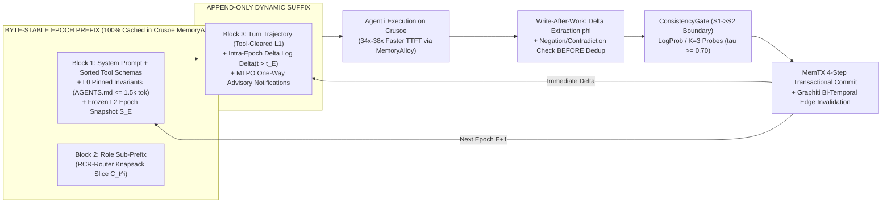

# Deep Research: Recursive, Self-Verifying, Shared-Memory, and Self-Evolving Agent Teams on Crusoe Managed Inference ("Done Means Done", "Shared Brain", and "Version N+1")

## Executive Summary

The **Crusoe Recursive Agents Hackathon** (*"Build a team of agents you can walk away from"*, hosted by [Cerebral Valley & Crusoe](https://cerebralvalley.ai/e/crusoe-recursive-agents-hackathon)) targets the three structural bottlenecks that prevent today's LLM agents from operating unattended over long horizons: **unverified completion & looping ("Done Means Done")**, **stateless context duplication & conflicting concurrent state ("Shared Brain")**, and **zero cross-run learning ("Version N+1")**. Across 86 recent research papers and 29 scraped technical specifications analyzed in this study, empirical telemetry shows why standard multi-agent loops fail: vanilla coding agents exhibit behavioral drift in **78.3%–86.2% of trajectories** ([`arXiv:2608.06701`](https://arxiv.org/abs/2608.06701)), burn a median of **900K–1.2M tokens** on failing runs ([`arXiv:2506.18824`](https://arxiv.org/abs/2506.18824)), duplicate **47.3% of knowledge discovery** across uncoordinated teammates ([`arXiv:2510.10585`](https://arxiv.org/abs/2510.10585)), suffer **58.4% hallucination survival** when unverified claims enter shared memory ([`arXiv:2608.14588`](https://arxiv.org/abs/2608.14588)), and score **below a zero-shot baseline in 49% of naive prompt-optimization runs** when mutated without held-out validation gating ([`arXiv:2604.14585`](https://arxiv.org/abs/2604.14585)).

Crucially, **Crusoe Managed Inference** ([crusoe.ai/cloud/managed-inference](https://www.crusoe.ai/cloud/managed-inference)) provides three architectural primitives that uniquely solve these bottlenecks when co-designed with the agent harness:
1. **Cluster-Wide `MemoryAlloy™` Distributed KV-Cache Fabric** ([Crusoe MemoryAlloy Deep Dive](https://www.crusoe.ai/resources/blog/crusoe-memoryalloy-reinventing-kv-caching-for-cluster-scale-inference)): Decouples KV cache segments from individual GPU processes across NVLink/RDMA, delivering **up to 9.9× faster Time-to-First-Token (TTFT)** (and up to **34×–38× faster TTFT** on 110K-token shared prefixes), **5× higher throughput**, and **4× cheaper cached input tokens** ($0.25/1M vs. $1.00/1M on `Nemotron-3-Ultra`). An agent team that structures its **Shared Brain** and **Version N+1 Genome** as a **byte-stable epoch prefix** with an append-only delta suffix turns MemoryAlloy into a physical hardware shared-memory bus.
2. **Multi-Family Open-Weight Model Catalog on One OpenAI-Compatible Endpoint** (`https://api.inference.crusoecloud.com/v1`, [Crusoe Available Models](https://docs.crusoecloud.com/serverless-inference/available-models)): Hosting **NVIDIA Nemotron 3 Ultra (550B-A55B)**, **Nemotron 3 Super (120B-A12B)**, **Nemotron 3.5 Lightning (30B-A3B, 1M context)**, **Nemotron 3 Nano Omni Reasoning (30B-A3B, $0.30/1M input)**, **DeepSeek V4 Pro (861B, 1M context)**, **Z.ai GLM-5.3 (753B, 1M context)**, **Google Gemma 4 31B**, and **Alibaba Qwen 3.8 27B** enables both **cost-optimal model tiering** ([Crusoe Deep Agents Walkthrough](https://www.crusoe.ai/resources/blog/nvidia-nemotron-3-ultra-langchain-deep-agents-on-crusoe-managed-inference)) and **cross-family heterogeneous verification juries** (`RoPoLL`, [`arXiv:2606.30931`](https://arxiv.org/abs/2606.30931))—while multiplying aggregate rate limits because Crusoe enforces **2,000,000 TPM and 600 RPM independently per model** ([Crusoe Rate Limits](https://docs.crusoecloud.com/serverless-inference/rate-limits/)).
3. **Real-Time Prometheus Telemetry API** ([Crusoe Inference Metrics](https://docs.crusoecloud.com/serverless-inference/inference-metrics/)): Exposes live per-model `inference_counter_cached_prompt_token` (prefix cache hit rate), TTFT/TPOT histograms, and token throughput via PromQL (`https://api.cloud.crusoe.ai/v1/projects/<project-id>/metrics/timeseries`), allowing a hackathon team to prove hardware-level efficiency and quality gains with live infrastructure metrics.

Rather than treating the three hackathon prompts as isolated tracks, the highest-leverage winning strategy is to build **one unified closed-loop recursive system—The Ouroboros Engine on Crusoe**—where **Track 1 ("Done Means Done")** serves as the runtime compiler and deterministic/multi-family verification gate, **Track 2 ("Shared Brain")** serves as the transactional, prefix-aligned memory substrate (`MemTX` + `Graphiti` + `MemoryAlloy`), and **Track 3 ("Version N+1")** uses Track 1's verifier receipts and Track 2's provenance graph to evolve the team's prompts, metaskills, tools, and topology across runs under a strict repair-vs-regression gate ($u = |R| - 2|B| > 0$).

---

## Key Findings

1. **Crusoe's Own Engineering Blogs Foreshadow the Exact Hackathon Thesis:** In September 2026, Crusoe published two blueprint guides by Senior DevRel Manager Emmanuel Acheampong—[*NVIDIA Nemotron 3 Ultra + LangChain Deep Agents on Crusoe Managed Inference*](https://www.crusoe.ai/resources/blog/nvidia-nemotron-3-ultra-langchain-deep-agents-on-crusoe-managed-inference) and [*Running Nous Research's Hermes Agent on Crusoe Managed Inference*](https://www.crusoe.ai/resources/blog/running-nous-researchs-hermes-agent-on-crusoe-managed-inference). The first highlights **harness engineering** (where an evaluator agent analyzes failing traces and mutates prompts, tool descriptions, and middleware without touching model weights, lifting Nemotron 3 Ultra to **86.6% accuracy at 10× lower cost** than closed frontier models). The second highlights Hermes v0.12.0's **Autonomous Curator** running on `nvidia/Nemotron-3-Nano-Omni-Reasoning-30B-A3B` to grade, deduplicate, and prune skills in the background.
2. **When Agents Write Both Specs and Code, 100% of Defective Formal Specs Still Pass Verification Unless Checked by Blind Back-Translation (`claimcheck`):** In [`arXiv:2610.17358`](https://arxiv.org/abs/2610.17358), **100% of weak/narrow specifications** synthesized by LLMs still passed the formal Dafny verifier (e.g., asserting `r*r <= N` while omitting `(r+1)*(r+1) > N`, which is trivially satisfied by `r = 0`). Direct LLM-as-a-Judge checks fail because seeing the formal spec biases the judge; **blind back-translation** (informalizing the test/spec $\psi \to \hat{g}$ without seeing user goal $g$, then comparing $(g, \hat{g})$ without seeing $\psi$) improves macro recall on defective specs by **+8.2 to +9.8 points** ([`arXiv:2610.17358`](https://arxiv.org/abs/2610.17358)), while version-space clausal coverage (`Monty`, [`arXiv:2607.13303`](https://arxiv.org/abs/2607.13303)) improves assertion precision by **+20 points**.
3. **Homogeneous Self-Verification and Arithmetic-Mean LLM Juries Break Under Contamination; Geometric Median over Heterogeneous Models (`RoPoLL`) Is Provably Robust:** LLMs exhibit perplexity-driven self-preference bias ([NeurIPS 2024 #106181](https://neurips.cc/virtual/2024/106181)). Furthermore, [`arXiv:2606.30931`](https://arxiv.org/abs/2606.30931) (`RoPoLL`) proves that standard arithmetic-mean Panel of LLMs (`PoLL`, [`arXiv:2404.18796`](https://arxiv.org/abs/2404.18796)) has a **breakdown point of 0** (unbounded bias when even one judge suffers sycophancy, mode collapse, or refusal). Aggregating multi-dimensional judge scores via the **Weiszfeld Geometric Median** achieves the optimal **$1/2$ breakdown point**, allowing a heterogeneous 3-model committee (e.g., `Nemotron-3-Super` + `DeepSeek-V4-Pro` + `GLM-5.3` on Crusoe) to beat a single 675B judge by **1.31×** under 30% corruption ([`arXiv:2606.30931`](https://arxiv.org/abs/2606.30931)).
4. **Millisecond Deterministic & Telemetry Watchdogs Beat Per-Step LLM Judges on Drift/Loop Detection and Recover 45% of Failing Runs:** Single-pass LLM judges miss **82% of context corruptions** (`p_detect = 0.18`, [`arXiv:2608.02464`](https://arxiv.org/abs/2608.02464)). By contrast, pairing a deterministic grounding/coverage verifier (**96% combined detection at 0% false positives**) with a **200 $\mu$s Echo State Network + per-channel CUSUM** telemetry monitor detects **71% of mid-episode failures (AUROC 0.872)** and, via checkpoint rollback-and-retry, **recovers 45% of failed trajectories ($p=0.0005$), lifting task success from 52% to 73%** ([`arXiv:2608.02464`](https://arxiv.org/abs/2608.02464)). Similarly, `LivePlan`'s rule-based phase/graph monitor (`Graphectory` + `Langutory`) paired with an on-demand LLM advisor boosts SWE-bench Verified/Pro resolution by **up to +15.2% (mean +9.9%) at \$0.01–\$0.08 per instance** ([`arXiv:2608.06701`](https://arxiv.org/abs/2608.06701)).
5. **Verbalized Confidence Is Unfaithful to Agent Decisions; Escalation and Replanning Must Be Governed by External Signals and Cooldown Gates:** LLMs suffer severe post-RLHF overconfidence (ECE $\ge 0.30$–$0.427$, [`arXiv:2502.11028`](https://arxiv.org/abs/2502.11028)) and structurally fail to use their own verbalized uncertainty to alter action choices ([`arXiv:2601.07767`](https://arxiv.org/abs/2601.07767)). Moreover, unconstrained replanning causes "replanning churn" with **85.5%–100% deadline violations**; enforcing `BRACE`'s cooldown ($\delta$) and plan-commit ($\omega$) stability gates cuts replanning tokens by **62%–92%** ([`arXiv:2608.01428`](https://arxiv.org/abs/2608.01428)).
6. **Uncoordinated Multi-Agent Teams Duplicate 47.3% of Work, and Classical Database Locks (2PL/OCC) Fail on Agent Transactions:** Without structured shared memory, multi-agent teams exhibit a **47.3% knowledge duplication rate** ([`arXiv:2510.10585`](https://arxiv.org/abs/2510.10585)), and uncoordinated parallel writes pass only **13% of trials** ([`arXiv:2606.15376`](https://arxiv.org/abs/2606.15376)). Because agent transactions span minutes of inference, Two-Phase Locking (2PL) deadlocks **0.81 times/trial** ($1.04\times$ speedup) and Optimistic Concurrency Control (OCC) aborts **0.95 times/trial** ($0.93\times$ speedup, $1.83\times$ token cost). **Monotonic Trajectory Pre-Order (`MTPO`, [`arXiv:2606.15376`](https://arxiv.org/abs/2606.15376))**—which uses speculative writes + one-way advisory notifications + LLM self-healing—achieves **within 5% of serial correctness at $1.4\times$ speedup and $1.15\times$ token cost**.
7. **"A Memory Write Is Not a Belief Commit" (`MemTX` + `Hallucination Snowball`):** In multi-agent pipelines, unverified claims evolve through a 4-state Markov chain ($S_1 \text{ Raw} \to S_2 \text{ Derived} \to S_3 \text{ Narrative} \to S_4 \text{ Invisible}$); once a fabrication reaches $S_3$, **89.3% are invisible** to post-hoc fact-checkers ([`arXiv:2608.14588`](https://arxiv.org/abs/2608.14588)). Placing a verification gate (`ConsistencyGate`, [`arXiv:2607.22962`](https://arxiv.org/abs/2607.22962), + `MemTX` 8-state belief lifecycle, [`arXiv:2607.23929`](https://arxiv.org/abs/2607.23929)) at the **$S_1 \to S_2$ write boundary** catches **75.4% of fabrications** and cuts end-to-end hallucination survival from **58.4% down to 16.2%** ($p < 10^{-6}$).
8. **Role-Conditioned Context Routing (`RCR-Router`) + Bi-Temporal Graphs (`Graphiti`) + `MemoryAlloy` Prefix Alignment Cut Token Costs by 80%–90% While Raising Quality:** `RCR-Router` ([`arXiv:2508.04903`](https://arxiv.org/abs/2508.04903)) formulates read-before-work as a role- and stage-conditioned knapsack problem, cutting token usage by **35%** and runtime by **38%** while lifting multi-hop QA F1 from **59.1% (Full-Context) to 67.3%**. Pairing `Graphiti` bi-temporal edge invalidation ([`arXiv:2501.13956`](https://arxiv.org/abs/2501.13956)) with **epoch-frozen prefix alignment** ([`arXiv:2601.06007`](https://arxiv.org/abs/2601.06007)) preserves byte-identical prefixes across all subagents on Crusoe's `MemoryAlloy` fabric.
9. **Self-Evolution Without a Held-Out Selection Gate Can Collapse Performance by 68% (`RSEA` & `GSO`):** In [`arXiv:2606.28374`](https://arxiv.org/abs/2606.28374) (`RSEA`), unguarded online memory curation (`Dynamic Cheatsheet`, [`arXiv:2504.07952`](https://arxiv.org/abs/2504.07952)) collapsed WebShop performance from **0.429 (vanilla ReAct) to 0.136 (a 68% drop)** due to context distraction, and removing `RSEA`'s held-out gate caused a **33.3-point train-to-test collapse** (100% in-sample vs. 66.7% held-out). Similarly, [`arXiv:2609.39148`](https://arxiv.org/html/2609.39148v2) (`GSO`) showed that **16 of 21 self-evolved static skills lost training gains on unseen tasks** because iterative editors turn one-off fixes into unconditional global rules. Evolving a **6-part Metaskill** under an asymmetric repair-vs-regression gate ($u = |R| - 2|B| > 0$) beat all 5 skill-evolution baselines by **+4.3 to +22.5 percentage points** across 6 benchmarks ([`arXiv:2609.39148`](https://arxiv.org/html/2609.39148v2)).
10. **Two-Timescale Evolution (`TacoMAS` + `Maestro` + `STEVE`) Prevents Coordination Instability and Catastrophic Forgetting:** Computing textual gradients on already-correct runs degrades GSM8K accuracy from **86.2% (error-only) to 76.5% (correct-only)** (`STEVE`, [`arXiv:2609.23716`](https://arxiv.org/abs/2609.23716)). Optimal self-evolution updates **prompts/metaskills/tools on a fast timescale** from failed traces (`dspy.GEPA` + `STEVE` preservation pool) and **multi-agent graph topology on a slow timescale** (`Maestro` G-step, [`arXiv:2509.04642`](https://arxiv.org/abs/2509.04642); `TacoMAS`, [`arXiv:2605.09539`](https://arxiv.org/abs/2605.09539)), yielding **+13.3% to +65.7%** gains over static teams.

---

## Detailed Analysis

### 1. Platform Foundation: Co-Designing for Crusoe Managed Inference

Before architecting the three tracks, we map the exact hardware, runtime, and API capabilities of **Crusoe Managed Inference** ([docs.crusoecloud.com/serverless-inference/overview](https://docs.crusoecloud.com/serverless-inference/overview/)):

#### 1.1 Live Model Catalog & Multi-Pool Rate-Limit Multiplication
All Serverless Inference models are served via an OpenAI-compatible endpoint (`https://api.inference.crusoecloud.com/v1`) and native `langchain-crusoe` (`ChatCrusoe`) integration ([Quickstart Docs](https://docs.crusoecloud.com/quickstart/getting-started-with-serverless-inference/)). Crucoe enforces rate limits **independently per project and per model** (`500,000 TPM / 30 RPM` without payment method; `2,000,000 TPM / 600 RPM` with payment method, returning `x-ratelimit-remaining-tokens` and `x-ratelimit-remaining-requests` headers on every call, [Rate Limits Docs](https://docs.crusoecloud.com/serverless-inference/rate-limits/)).

| Role in Recursive Agent Team | Primary Crusoe Model ID(s) | Architecture & Context | Strategic Purpose in Hackathon Architecture |
| :--- | :--- | :--- | :--- |
| **Orchestrator, DoD Compiler & Meta-Evolver** | `nvidia/NVIDIA-Nemotron-3-Ultra-550B-A55B` or `deepseek-ai/DeepSeek-V4-Pro` | 550B MoE (55B active, Hybrid Mamba-Transformer, 1M ctx) / 861B (1M ctx) | High-reasoning ("`xhigh`" sandwich) spec synthesis, `LivePlan` drift advisor, `Maestro`/`GEPA` genome mutation ([Crusoe Nemotron Ultra Blog](https://www.crusoe.ai/resources/blog/nvidia-nemotron-3-ultra-langchain-deep-agents-on-crusoe-managed-inference)). |
| **Parallel Worker / Coding Subagents** | `nvidia/Nemotron-3-Super-120B-A12B` & `nvidia/nemotron-3.5-lightning-30b-a3b` | 120B MoE (12B active, 262K ctx, FP8) & 30B MoE (3B active, **1M ctx**, NVFP4) | Fast parallel implementation, repo navigation, and test execution across separate 600 RPM model pools ([Available Models](https://docs.crusoecloud.com/serverless-inference/available-models)). |
| **Heterogeneous Verifier Jury (`RoPoLL`) & Blind Informalizer (`claimcheck`)** | `zai/GLM-5.3` (753B, 1M ctx), `qwen/Qwen3.8-27B` (256K ctx), `google/gemma-4-31b-it` (262K ctx), `openai/gpt-oss-120b` (128K ctx) | 4 distinct non-NVIDIA model families | Eliminates perplexity-driven self-preference bias ([NeurIPS #106181](https://neurips.cc/virtual/2024/106181)) when judging `Nemotron`-generated code and specs. |
| **Memory Curator, RCR-Router & Fast Gate (`ConsistencyGate`)** | `nvidia/Nemotron-3-Nano-Omni-Reasoning-30B-A3B` & `nvidia/Nemotron-3-Nano-30B-A3B` | ~3B active MoE, 262K ctx, Multimodal ($0.30/1M input) | Low-latency logprob fact verification (23–28 ms), sleep-time memory consolidation, and Hermes-style skill curation ([Crusoe Hermes Blog](https://www.crusoe.ai/resources/blog/running-nous-researchs-hermes-agent-on-crusoe-managed-inference)). |

#### 1.2 Hardware Symbiosis: Exploiting `MemoryAlloy™` & PromQL Telemetry
Crusoe's proprietary `MemoryAlloy™` engine ([MemoryAlloy Technical Blog](https://www.crusoe.ai/resources/blog/crusoe-memoryalloy-reinventing-kv-caching-for-cluster-scale-inference)) uses Rust-based Unified Memory services, GPU `Shadow Pools`, and a multi-rail `Send Graph` (aggregating 80–130 GB/s to a single GPU and >250 GB/s across 8 GPUs over NVLink + RDMA) paired with a **KV-aware TTFT-estimating Gateway**.
* When multiple subagents share a common prompt prefix, `MemoryAlloy` reuses precomputed KV segments across the entire cluster—delivering **21× faster TTFT at 30K tokens** and **34×–38× faster TTFT at 110K tokens**, while cutting cached input token billing by **75%** ($0.25/1M vs. $1.00/1M) and energy per token by **23%** ([How Green Is Crusoe's Inference Engine](https://www.crusoe.ai/resources/blog/how-green-is-crusoes-inference-engine)).
* Furthermore, our agent harness can query Crusoe's live **Prometheus API** (`https://api.cloud.crusoe.ai/v1/projects/<project-id>/metrics/timeseries`, [Metrics Docs](https://docs.crusoecloud.com/serverless-inference/inference-metrics/)) to display real-time **Prefix Cache Hit Rate** (`inference_counter_cached_prompt_token / inference_counter_prompt_token`) and **Median/P95 TTFT** (`inference_histogram_first_token_latency_bucket`) directly inside the hackathon demo UI.

---

### 2. Track 1 Deep Dive: "Done Means Done" (Autonomous Specification Synthesis, Heterogeneous Verification, Drift/Loop Detection, and Calibrated Escalation)

```mermaid
flowchart TD
    G["1-Line User Goal g"] --> A1["Stage A1: Repo Grounding & 8-Section PromptContract\n(Nemotron-3-Ultra)"]
    A1 --> A2["Stage A2: Blind Back-Translation Gate (claimcheck)\npsi -> M_inf (GLM-5.3) -> g_hat -> M_judge (DeepSeek-V4)"]
    A2 -->|Conformance c_bar < 0.6| A1
    A2 -->|Conformance c_bar >= 0.6| A3["Stage A3: TiCoder/Monty Ambiguity & Mutation Check\n(Mutant Kill Rate >= 90%)"]
    A3 -->|Ambiguous Edge Input x_edge| H1["RARE PING HUMAN (Condition H1)\nSingle Discriminative I/O Question"]
    A3 -->|Unambiguous Executable DoD D(g)| EX["Worker Subagent Execution\n(Nemotron-3-Super / 3.5-Lightning)\nwith PreToolUse Scope Guard"]
    EX --> MON["3-Tier Real-Time Watchdog (< 2ms/step)\n1. Canonical SHA256 Action/Obs + 2x2 Matrix\n2. LivePlan Graphectory/Langutory 10 Drift Rules\n3. 200us ESN + Per-Channel CUSUM (s_t > theta)"]
    MON -->|No Drift & Not Submitted| EX
    MON -->|Drift / Loop Alarm & r_replan < R_max| RP["RE-PLAN (BRACE Cooldown/Commit Gate)\nRollback to Clean Checkpoint + Negative Memory + Advisor"]
    RP --> EX
    MON -->|Submitted Candidate| V1["Layer 1: Deterministic Gate (< 1ms)\nScope Guard + AST Anti-Mock + DoD Tests + Provenance Grounding"]
    V1 -->|Fail| RP
    V1 -->|Pass| V2["Layer 2 & 3: Behavioral QA + Heterogeneous RoPoLL Jury\n(GLM-5.3 + Qwen-3.8 + Gemma-4 Weiszfeld Geometric Median)"]
    V2 -->|Pass & Low Entropy H <= tau_H| DONE["STOP: COMPLETED_VERIFIED\nImmutable Verification Receipt"]
    V2 -->|High Verdict Entropy H > tau_H| H2["RARE PING HUMAN (Condition H2)\nContested Atomic Claim Resolution"]
```

#### 2.1 Compiling a 1-Line Goal into an Executable Definition of Done (DoD)
When given a 1-line prompt $g$, agents silently fill in assumptions from training priors ([RiSE MSR Intent Formalization](https://risemsr.github.io/blog/2026-03-05-shuvendu-intent-formalization/), [`arXiv:2603.17150`](https://arxiv.org/abs/2603.17150)). Worse, if the same agent writes both tests and implementation, it writes weak/tautological tests that pass trivially. Our **4-Stage DoD Compiler** enforces strict separation of duties:
1. **8-Section `PromptContract` Synthesis** ([Prompt Contracts](https://understandingdata.com/posts/prompt-contracts-specification-before-code/), [`arXiv:2510.12702`](https://arxiv.org/abs/2510.12702)): Before any code edit, the **Spec Architect Agent** (`Nemotron-3-Ultra`) scans the workspace (`LocalContextMiddleware`, [LangChain Harness Engineering](https://www.langchain.com/blog/improving-deep-agents-with-harness-engineering)) and emits a typed JSON contract containing: `objective`, `pre_conditions`, `invariants` (protected files/tests), `scope_and_deliverables` (enforced by a deterministic `PreToolUse` Scope Guard hook that blocks writes outside the allowlist or to test files during implementation), `implementation_contract`, `test_first_spec` (executable pytest/property tests written *before* implementation), `acceptance_criteria` (5C rubric: Countable, Constrained, Comparable, Checkable via CLI, Cheap), and `anti_patterns` (*"no mock-only tests"*, *"no hardcoded return literals"*).
2. **`claimcheck` Blind Back-Translation Gate ([`arXiv:2610.17358`](https://arxiv.org/abs/2610.17358)):**
   - **Blind Informalizer ($M_{\text{inf}}$, e.g., `zai/GLM-5.3`):** Receives *only* the synthesized test suite/assertions $\psi$ and code signatures—**never the user prompt $g$**—and translates $\psi$ back into natural language $\hat{g} = M_{\text{inf}}(\psi)$ describing exactly what $\psi$ enforces (including whether degenerate outputs like `[]`, `0`, or `None` would pass).
   - **Blind Semantic Judge ($M_{\text{judge}}$, e.g., `deepseek-ai/DeepSeek-V4-Pro`):** Receives *only* $(g, \hat{g})$—**never $\psi$** (showing $\psi$ degrades macro recall by 1.4–4.5 points)—and computes `Monty`'s bidirectional clausal conformance score $\bar{c}(\psi) \in [-1, 1]$ across $k=8$ samples ([`arXiv:2607.13303`](https://arxiv.org/abs/2607.13303)). Any spec with $\bar{c}(\psi) < 0.6$ is rejected and regenerated.
3. **Mutation Completeness & Discriminative Ambiguity Check (`TiCoder`, [`arXiv:2208.05950`](https://arxiv.org/abs/2208.05950); [`arXiv:2603.17150`](https://arxiv.org/abs/2603.17150)):**
   - Synthesize semantic output mutants $\text{Mut}(T)$ (off-by-one, empty return, dropped filter, null field) and require the synthesized DoD test suite $T_{\text{DoD}}$ to kill $\ge 90\%$ of mutants:
     $$\text{Completeness}(T_{\text{DoD}}) = \frac{|\{(i, o') \in \text{Mut}(T_{\text{DoD}}) : T_{\text{DoD}}(i, o') = \text{FAIL}\}|}{|\text{Mut}(T_{\text{DoD}})|} \ge 0.90$$
   - Sample $K=3$ lightweight candidate output predictions on boundary inputs $x_{\text{edge}}$. If two candidates disagree ($p_1(x_{\text{edge}}) \neq p_2(x_{\text{edge}})$) while both satisfy $\bar{c} \ge 0.6$, the compiler detects a genuine **Intent Ambiguity** before wasting compute.

#### 2.2 Three-Layer Heterogeneous Verification Stack
Following OpenHands' production **Verification Stack** ([OpenHands Verification Stack Blog](https://www.openhands.dev/blog/20260506-the-verification-stack), which cut mean time-to-merge by **58%** and raised test coverage by **25%** across 900+ PRs):
* **Layer 1 — Deterministic Execution & Provenance Gate ($<1\text{ ms}$, Zero Tokens):**
  1. Verify `git diff --name-only` respects `scope_and_deliverables` and touches zero files in `invariants` or `T_DoD`.
  2. Run $T_{\text{orig}} \cup T_{\text{DoD}}$ in a sandbox and run an AST visitor over $T_{\text{DoD}}$ to reject mock-only assertions that do not exercise target functions.
  3. Run [`arXiv:2608.02464`](https://arxiv.org/abs/2608.02464)'s **Deterministic Grounding & Coverage Verifier**: verify that every required verification tool call was executed and recompute any reported numeric metrics directly from raw tool stdout receipts (**96% combined detection rate, 0/63 false positives, 26/26 fabrications caught**).
* **Layer 2 — Behavioral QA Verifier Agent ([`arXiv:2601.05111`](https://arxiv.org/abs/2601.05111)):** A separate model family (`DeepSeek-V4-Pro`) executes OpenHands' 4-phase behavioral QA loop (*Understand $\to$ Setup $\to$ Exercise $\to$ Report*), probing the running artifact with adversarial boundary inputs not seen during generation.
* **Layer 3 — Heterogeneous `RoPoLL` + `JuryFlow` Panel ([`arXiv:2606.30931`](https://arxiv.org/abs/2606.30931); [`arXiv:2609.40103`](https://arxiv.org/abs/2609.40103)):**
  - Decompose residual rubric criteria into atomic claims $\{c_1, \dots, c_M\}$.
  - Three heterogeneous judges on Crusoe (`zai/GLM-5.3`, `qwen/Qwen3.8-27B`, `google/gemma-4-31b-it`) score each claim **independently without seeing each other's outputs** (avoiding the bandwagon and downward biases of multi-agent debate documented in [`arXiv:2505.19477`](https://arxiv.org/abs/2505.19477) and [`arXiv:2608.30373`](https://arxiv.org/abs/2608.30373)).
  - Aggregate judge score vectors $\mathbf{y}_j \in \mathbb{R}^d$ via the **Weiszfeld Geometric Median** ([`arXiv:2606.30931`](https://arxiv.org/abs/2606.30931)):
    $$\mathbf{y}^{(t+1)} = \left(\sum_{j=1}^N \frac{\mathbf{y}_j}{\max(\|\mathbf{y}^{(t)} - \mathbf{y}_j\|_2, \eta)}\right) \bigg/ \left(\sum_{j=1}^N \frac{1}{\max(\|\mathbf{y}^{(t)} - \mathbf{y}_j\|_2, \eta)}\right)$$
    and compute claim-level Shannon verdict entropy $H(c_m) = -\sum_v p_m(v)\log p_m(v)$ ([`arXiv:2609.40103`](https://arxiv.org/abs/2609.40103)).

#### 2.3 Real-Time Loop & Trajectory Drift Detection Engine ($<2\text{ ms/step}$)
Because LLM self-monitoring fails once the context window is polluted with repeated errors ([`arXiv:2610.19376`](https://arxiv.org/abs/2610.19376) `DeLoop`), our harness runs three non-LLM watchdogs after every tool step $t$:
1. **Canonical Action-Observation Fingerprinting & 2×2 Progress Matrix** ([OpenHands StuckDetector](https://docs.openhands.dev/sdk/guides/agent-stuck-detector), `openhands/openhands#15087`, `openhands/software-agent-sdk#4332`, [IronCurtain Loop Detection](https://github.com/provos/ironcurtain/blob/d51a3467cbda6a2e94cf04e885e8ae1abdd0f6be/docs/designs/loop-detection.md)):
   - Strip variable `thought` monologues and timestamps to compute canonical hashes $h_{\text{act}}(a_t) = \text{SHA256}(\text{tool}(a_t) \| \text{canonical\_json}(\text{args}(a_t)))$ and $h_{\text{obs}}(o_t) = \text{SHA256}(\text{exit\_code} \| \text{norm\_output})$.
   - Track the 5 OpenHands stuck patterns (4× identical $(h_{\text{act}}, h_{\text{obs}})$; 3× identical error nudge $\to$ 4× hard stuck; $\ge 3$ monologue turns without tools; 6-step $A \leftrightarrow B$ ping-pong oscillation; context-condensation loop) plus a per-file edit cap ($\ge 5$ edits to the same file without increasing passing test count).
   - Apply the **World-Changed Exemption**: if $h_{\text{act}}$ repeats but $h_{\text{obs}}$ progresses (e.g., polling a build/training job, `openhands/software-agent-sdk#762`), classify as *World Changed* rather than stuck.
2. **Process-Centric Phase Grammar (`LivePlan`, [`arXiv:2608.06701`](https://arxiv.org/abs/2608.06701)):**
   - Map every step to $\Sigma = \{\texttt{Navigate (N)}, \texttt{Reproduce (R)}, \texttt{Patch (P)}, \texttt{Validate (V)}, \texttt{Submit (S)}\}$ and maintain execution graph `Graphectory` $G_t$.
   - Enforce `LivePlan`'s 10 deterministic drift rules: **Blocking Drifts** (*Premature Patching* before $\texttt{N}/\texttt{R}$, *Skip Patching*, *Skip Validation* $\texttt{P} \to \texttt{S}$ without intervening $\texttt{V}$, and cycle oscillation in $G_t$) intercept and block the tool call immediately; **Non-Blocking Drifts** (prolonged single-phase stagnation $>12$ steps or unmotivated file revisits) trigger on-demand Advisor steering.
3. **Sub-Millisecond Multi-Channel CUSUM Change-Point Detector ([`arXiv:2608.02464`](https://arxiv.org/abs/2608.02464)):**
   - Track step telemetry channels $c \in \{\text{embedding drift } e, \text{token entropy } u, \text{tool metadata } m, \text{numeric grounding } g\}$ via one-sided sequential CUSUM:
     $$S_t^{(c)} = \max\Big(0, \; S_{t-1}^{(c)} + z\big(q_t^{(c)}\big) - \kappa\Big), \quad s_t = \max_{c \in \{e,u,m,g\}} S_t^{(c)}$$
   - Alarm fires when $s_t > \theta_{1-\beta}$.

#### 2.4 Formal Controller Policy: Continue / Re-Plan / Stop / Ping Human
At step $t$, the controller evaluates $\sigma_t = (V_{\text{det}}(t), \hat{\mathbf{y}}_{\text{GM}}(t), H_{\max}(t), s_t^{\text{CUSUM}}, \text{drift}_t, \Delta_t, \kappa_t, r_{\text{replan}}, B_{\text{rem}})$:
* **`STOP (COMPLETED_VERIFIED)`:** $V_{\text{det}}(t) = 1 \wedge \min_k \hat{y}_{\text{GM},k} \ge \tau_{\text{pass}} \wedge H_{\max}(t) \le \tau_H \wedge \neg\text{SkipValidation}(L_t)$. Emits a signed verification receipt.
* **`RE-PLAN (BUDGETED ROLLBACK + ADVISOR)`:** Governed by `BRACE`'s stability gate ([`arXiv:2608.01428`](https://arxiv.org/abs/2608.01428)) with cooldown window $\delta$ and commit window $\omega$:
  $$u_t = \mathbb{I}\Big[\big(\text{drift}_t \in \text{Blocking} \vee s_t^{\text{CUSUM}} > \theta_{1-\beta}\big) \vee \big(\text{drift}_t \in \text{NonBlocking} \wedge \Delta_t \ge \delta \wedge \kappa_t \ge \omega\big)\Big]$$
  When $u_t = 1$ and $r_{\text{replan}} < R_{\max} = 3$: roll back the working tree and context to the last clean checkpoint before drift onset $\hat{\tau}$ (`E-RECAP` context pruning, [`arXiv:2608.01428`](https://arxiv.org/abs/2608.01428)), record the failed action hash $h_{\text{act}}$ in the **Negative Memory / Anti-Pattern table** ([`arXiv:2608.06811`](https://arxiv.org/abs/2608.06811)), and invoke the `Nemotron-3-Ultra` Advisor to emit a new plan that explicitly forbids $h_{\text{act}}$.
* **`PING HUMAN (RARE, HIGH-VoI ESCALATION)`:** Triggered *only* when $\text{VoI}(q) > C_{\text{interrupt}}$ under three exact conditions: **(H1)** `TiCoder`/`Monty` discriminative ambiguity on $x_{\text{edge}}$ at Stage A3; **(H2)** persistent judge verdict entropy $H(c^*) > \tau_H$ after evidence retrieval ([`arXiv:2609.40103`](https://arxiv.org/abs/2609.40103)); or **(H3)** an action requires crossing an irreversible/protected invariant boundary ([`doi:10.1007/s11023-026-09783-y`](https://doi.org/10.1007/s11023-026-09783-y)). Every human ping is formatted as a single binary or two-choice input-output question.
* **`STOP (GRACEFUL BOUNDED ABORT)`:** When $r_{\text{replan}} = R_{\max}$ or budget $B_{\text{rem}} \le B_{\min}$ with $V_{\text{det}} = 0$, revert uncommitted edits and emit a structured `TaskOutcome` receipt detailing passing/failing DoD checks and exact reproduction steps.

---

### 3. Track 2 Deep Dive: "Shared Brain" (Conflict-Free, Lean, Prefix-Aligned Multi-Agent Memory)



#### 3.1 Read-Before-Work / Write-After-Work Lifecycle
1. **7-Field `CAT7` Cognitive Memory Block (`MMP`, [`arXiv:2604.19540`](https://arxiv.org/abs/2604.19540)) + `MemClaw` Provenance ([`arXiv:2606.24535`](https://arxiv.org/abs/2606.24535)):**
   Every memory entry is scoped (`agent-local`, `team-shared`, `tenant-global`, `restricted`, [`arXiv:2505.18279`](https://arxiv.org/abs/2505.18279)) and stores: `(entity, attribute, claim, constraints[], evidence_refs[], role_domain, stage_tags[])`, plus `provenance` (`author_agent_id`, `source_authority`, `confidence`, `parent_hashes[]`, `content_hash`), `bitemporal` timestamps $(t_{\text{valid}}, t_{\text{invalid}}, t'_{\text{created}}, t'_{\text{expired}})$, and `MemTX` `belief_state`. Content-hash DAG lineage provides **$O(1)$ echo detection** (so an agent never mistakes its own echoed claim for independent peer confirmation) and **100% depth-4 provenance reconstruction at $p50 = 291\text{ ms}$** ([`arXiv:2606.24535`](https://arxiv.org/abs/2606.24535)).
2. **Read-Before-Work via Role-Conditioned Knapsack Routing (`RCR-Router`, [`arXiv:2508.04903`](https://arxiv.org/abs/2508.04903)):**
   Before Agent $i$ (role $R_i$, stage $S_t$) starts work, `RCR-Router` scores active (`t_invalid IS NULL`), `action-safe`/`committed` memory blocks via:
   $$\alpha(m; R_i, S_t) = w_1 \text{Sim}_{\text{role}}(m, R_i) + w_2 \text{Priority}_{\text{stage}}(m, S_t) + w_3 \exp(-\lambda(t - t_{\text{valid}}(m)))$$
   and solves the knapsack problem $\max_{C' \subseteq \mathcal{M}_t} \sum_{m \in C'} \alpha(m; R_i, S_t)$ subject to $\sum_{m \in C'} \text{Tokens}(m) \le B_i$. This cuts tokens by **35%** and runtime by **38%** while lifting multi-hop F1 from **59.1% to 67.3%** ([`arXiv:2508.04903`](https://arxiv.org/abs/2508.04903)).
3. **Write-After-Work via Two-Phase Reconciliation (`Mem0`, [`arXiv:2504.19413`](https://arxiv.org/abs/2504.19413)) & Sleep-Time Consolidation ([`arXiv:2504.13171`](https://arxiv.org/abs/2504.13171)):**
   After completing a task, `Nemotron-3-Nano-Omni` extracts candidate facts $\Omega = \{\omega_1, \dots, \omega_n\}$, runs **slot-keyed contradiction/negation detection *before* cosine deduplication** (fixing the `MemClaw` dedup-before-contradiction bug, [`arXiv:2606.24535`](https://arxiv.org/abs/2606.24535)), and adjudicates each fact via tool calls (`ADD`, `UPDATE`, `INVALIDATE`, `NOOP`). Heavy community summarization and Zettelkasten cross-linking (`A-MEM`, [`arXiv:2502.12110`](https://arxiv.org/abs/2502.12110)) run asynchronously during idle cycles (**5× reduction in active test-time compute**, [`arXiv:2504.13171`](https://arxiv.org/abs/2504.13171)).

#### 3.2 Conflict-Free Concurrent Updates & Anti-Poisoning Gates
1. **Monotonic Trajectory Pre-Order (`MTPO`, [`arXiv:2606.15376`](https://arxiv.org/abs/2606.15376)):** Assigns concurrent teammates a serialization order $\sigma = (T_1 \prec \dots \prec T_k)$ at dispatch. Writes are lock-free and speculative; if $T_i \prec T_j$ mutates an `(entity, attribute)` slot already read by $T_j$, the coordinator sends a **one-way advisory notification** $\Delta(T_i)$ to $T_j$'s inbox. At its next turn, $T_j$ dismisses benign updates in one step or selectively patches only tainted steps via saga compensation (**within 5% of serial correctness at $1.4\times$ speedup and $1.15\times$ token cost**).
2. **`MemTX` 8-State Transactional Belief Commit ([`arXiv:2607.23929`](https://arxiv.org/abs/2607.23929)):** Separates speculative scratchpads (`raw` $\to$ `tentative` $\to$ `validated`) from team-shared truth (`committed` $\to$ `action-safe`, plus `quarantined`, `superseded`, `revoked`). Promoting a write to `committed`/`action-safe` requires passing 4 atomic checks: (i) Evidence & Authority check ($\text{conf} \ge 0.60 \lor \text{auth} \ge 0.90$ with non-empty `evidence_refs`), (ii) Logical-time watermark check, (iii) Rule-based semantic conflict check on `(entity, attribute)` (higher authority supersedes; **equal authority with contradictory values transitions both to `quarantined`**), and (iv) Parent dependency-stability check.
3. **`Graphiti` Bi-Temporal Edge Invalidation ([`arXiv:2501.13956`](https://arxiv.org/abs/2501.13956)):** Contradictory updates never destructively overwrite history; they set $t_{\text{invalid}}(e_{\text{old}}) \leftarrow t_{\text{valid}}(e_{\text{new}})$, enabling $O(1)$ current-state queries (`WHERE t_invalid IS NULL`) alongside full point-in-time historical replay.
4. **Boundary Snowball Interception (`ConsistencyGate`, [`arXiv:2607.22962`](https://arxiv.org/abs/2607.22962)) + Dependency-Guided Rollback Repair ([`arXiv:2608.10502`](https://arxiv.org/abs/2608.10502)):** Every candidate write at the $S_1 \to S_2$ boundary is gated by `ConsistencyGate` ($\tau = 0.70$ over $K=3$ probes or 25 ms single-pass LogProb), cutting hallucination survival from **58.4% to 16.2%** ([`arXiv:2608.14588`](https://arxiv.org/abs/2608.14588)). If a committed memory is later disproven by a failing test, **Dependency-Guided Rollback Repair** traverses `parent_hashes` forward in the provenance DAG to quarantine all derived beliefs and replay only the affected agent steps (**85.3% recovery rate**, [`arXiv:2608.10502`](https://arxiv.org/abs/2608.10502)).

#### 3.3 L0/L1/L2 Tiering & Epoch-Aligned Prefix Caching on Crusoe `MemoryAlloy`
To maximize `MemoryAlloy` cache hits ($p_{\text{eff}} = (1-h)p + h p_c$, [`arXiv:2601.06007`](https://arxiv.org/abs/2601.06007); [TMLS Context Engineering](https://tmls.nyc/research/context-engineering)):
* **Block 1 (Byte-Identical Team Prefix):** System instructions + deterministically sorted tool JSON schemas + **L0 Pinned Invariants** (`AGENTS.md`, $\le 1,500$ tokens, never auto-summarized) + **Frozen L2 Epoch Snapshot $S_E$**. Shared 100% across all agents in Epoch $E$ on Crusoe's cluster-wide KV cache.
* **Block 2 (Role Sub-Prefix):** `RCR-Router` role playbook and domain slice.
* **Block 3 (Append-Only Dynamic Suffix):** L1 session trajectory (with `clear_tool_uses` stripping bulky raw file dumps after fact extraction, cutting 100-turn token costs by **84%**, [Anthropic Context Engineering Cookbook](https://platform.claude.com/cookbook/tool-use-context-engineering-context-engineering-tools)) + **Intra-Epoch Delta Log $\Delta(t > t_E)$**. Only when $|\Delta| > 2,000$ tokens does the coordinator fold $\Delta$ into $S_{E+1}$.

---

### 4. Track 3 Deep Dive: "Version N+1" (Self-Evolving Agent Genome with Monotone-Safe Held-Out Gating)

```mermaid
flowchart TD
    RUN["Run N Execution on D_evolve\n(Tracked as DAG G = (V, E))"] --> FILT{"Did Run Fail or\nViolate Efficiency Budget?\n(STEVE Error-Only Filter)"}
    FILT -->|No (Passed Cleanly)| ADD_P["Add Task to Preservation Pool D_preserve\n(Do NOT Compute Gradients on Passing Runs!)"]
    FILT -->|Yes (D_hard)| LOC["TRACE & GSO First-Fault Localization\n(Nemotron-3-Ultra / DeepSeek-V4-Pro)\nBlame Single Module m_k, Skill, Tool Desc, or Edge"]
    LOC --> SCALE{"Two-Timescale Evolution\n(TacoMAS / Maestro)"}
    SCALE -->|Every Run / Batch: Fast C-Step| MUT_C["Mutate Single Blamed Component via dspy.GEPA / RSEA\n- Metaskill section m_k (GSO)\n- Skill / Playbook (<= 15KB)\n- Tool Description (<= 500 chars)"]
    SCALE -->|Every K Runs if Plateaued: Slow G-Step| MUT_G["Maestro Trust-Region Topology Edit\nInsert Verifier Node / Synthesize Code Tool / Rewire Edge"]
    MUT_C --> GATE["4-Stage Monotone-Safe Acceptance Gate\n1. Hard Size Caps (<= +20%) & pytest 100%\n2. STEVE Preservation Pool (lambda_t = 1.5 + 0.1t)\n3. Disjoint Validation Split D_val: u = |R| - 2|B| > 0\n4. Strict Inequality (> not >=) & Token Budget Check"]
    MUT_G --> GATE
    GATE -->|u <= 0 or Regression| REV["git revert -> Keep Genome Version N"]
    GATE -->|u > 0 & Zero Invariant Break| COM["git commit -> Promote Genome Version N+1\nEvaluate Before vs. After on Locked Unseen D_test"]
```

#### 4.1 Post-Run Causal Credit Assignment Across Multi-Agent Traces
1. **Error-Only Gradient Trigger (`STEVE`, [`arXiv:2609.23716`](https://arxiv.org/abs/2609.23716)):** Never generate prompt/skill edits from passing runs! `STEVE` proves that computing textual gradients on already-correct examples injects noise that drops accuracy by **9.7 percentage points** (86.2% error-only vs. 76.5% correct-only). Passing tasks are routed to the **Generalization Preservation Pool $\mathcal{D}_{\text{preserve}}$**; only failed or budget-violating trajectories $\mathcal{D}_{\text{hard}}$ trigger reflection.
2. **Multi-Component Causal Attribution (`TRACE`, [`arXiv:2608.09153`](https://arxiv.org/abs/2608.09153)) + Single-Module Blame (`GSO`, [`arXiv:2609.39148`](https://arxiv.org/html/2609.39148v2)):**
   - Represent the multi-agent run as an execution DAG $\mathcal{G} = (\mathcal{V}, \mathcal{E})$ (`Trace/OPTO`, [`arXiv:2406.16218`](https://arxiv.org/abs/2406.16218)).
   - To avoid exploding or vanishing critiques in deep agent chains, apply **Textual Equilibrium Propagation (`TEP`, [`arXiv:2601.21064`](https://arxiv.org/abs/2601.21064))** (local node equilibrium refinement before bounded proximal edits).
   - `TRACE`'s exploratory diagnostic agent inspects the active genome files to classify whether the earliest diverging step in the trace stems from a **missing capability (`CREATE`)** or a **flawed instruction (`UPDATE`)** (**96% operation classification accuracy, 72.7% root-cause attribution accuracy**, [`arXiv:2608.09153`](https://arxiv.org/abs/2608.09153)) and maps blame to **at most one modular component $m_k$ per iteration** (`GSO`, [`arXiv:2609.39148`](https://arxiv.org/html/2609.39148v2)).

#### 4.2 The Versioned "Agent Genome" $\mathcal{G}_t$ & Two-Timescale Mutation
Following **RSEA** ([`arXiv:2606.28374`](https://arxiv.org/abs/2606.28374)), **GSO** ([`arXiv:2609.39148`](https://arxiv.org/html/2609.39148v2)), **Maestro** ([`arXiv:2509.04642`](https://arxiv.org/abs/2509.04642)), and **Nous Research's `hermes-agent-self-evolution`** ([GitHub Repo](https://github.com/NousResearch/hermes-agent-self-evolution), [PLAN.md](https://raw.githubusercontent.com/NousResearch/hermes-agent-self-evolution/0a929e3aa20e15cf04dc7c28492a7d41a5139125/PLAN.md)), the team's mutable state is stored in a Git-tracked directory `genome/` with four strictly typed artifacts:
1. **`strategy.md` ($\le 250$ tokens, `RSEA`):** High-level imperative policy priorities (`strategy`, `skills`, `playbook` separation lifts ALFWorld to **79.4%**, [`arXiv:2606.28374`](https://arxiv.org/abs/2606.28374)).
2. **`metaskill.yaml` (6 Modular Sections $m_1 \dots m_6$, `GSO`):** Instead of mutating static task skills—which overfit by turning one-off fixes into unconditional global rules on 16/21 skills ([`arXiv:2609.39148`](https://arxiv.org/html/2609.39148v2))—the team evolves a **6-part Metaskill** ($m_1$: task reading, $m_2$: tool selection, $m_3$: procedure synthesis, $m_4$: verification check, $m_5$: error diagnosis, $m_6$: bounded repair). At runtime on an unseen task $x$, `Nemotron-3-Nano-Omni` compiles an ephemeral checklist $s_x = C(m, x)$ tailored to $x$'s actual files, uses it for Run $N$, and **discards $s_x$ afterward** so task-specific details never pollute future runs (**+4.3 to +22.5 pts over all baselines**, [`arXiv:2609.39148`](https://arxiv.org/html/2609.39148v2)).
3. **`skills/` & `tools/registry.json` (`Hermes Self-Evolution` + `GEPA`):** Mutated via `dspy.GEPA` ([ICLR 2026 Oral](https://github.com/gepa-ai/gepa), which outperforms `MIPROv2` by ~13% and GRPO with 35× fewer rollouts) and cleaned up by the **Autonomous Curator** (`nvidia/Nemotron-3-Nano-Omni-Reasoning-30B-A3B`). Tool descriptions ($\le 500$ chars) are optimized from tool-misselection traces while keeping JSON parameter schemas frozen.
4. **`topology.json` (`Maestro` + `TacoMAS`):** Governed by `TacoMAS`'s **Two-Timescale Law** ([`arXiv:2605.09539`](https://arxiv.org/abs/2605.09539)):
   - **Fast Loop (Every Failed Batch — `Maestro` C-Step):** Mutate `metaskill.yaml`, `strategy.md`, or `tools/registry.json`.
   - **Slow Loop (Every $K$ Batches When C-Step Plateaus — `Maestro` G-Step):** Apply a trust-region graph edit to `topology.json`—inserting a specialized verifier/critic node, synthesizing a deterministic Python helper tool (`Darwin/Mendel Gödel Machine`, [`arXiv:2505.22954`](https://arxiv.org/abs/2505.22954), [`arXiv:2608.07645`](https://arxiv.org/abs/2608.07645)), or rewiring handoff edges (**+65.7% joint graph+config lift vs. +41.9% config-only**, [`arXiv:2509.04642`](https://arxiv.org/abs/2509.04642)).

#### 4.3 The 4-Stage Monotone-Safe Acceptance Gate & Held-Out Proof Protocol
To guarantee **Version $N+1$ is never worse than Version $N$** ([`arXiv:2606.28374`](https://arxiv.org/abs/2606.28374)) and prevent evaluator tampering (~50% rate in unguarded workspaces, [`arXiv:2603.11337`](https://arxiv.org/abs/2603.11337)), the evaluation harness runs in a **read-only permission-locked process** across **4 strictly disjoint task splits** ($\mathcal{D}_{\text{evolve}}$, $\mathcal{D}_{\text{preserve}}$, $\mathcal{D}_{\text{val}}$, $\mathcal{D}_{\text{test}}$):
1. **Gate 1 (Structural & Budget Invariants):** `pytest` 100% pass; prompt/skill size growth $\le +20\%$; tool JSON schemas unchanged ([Hermes PLAN.md](https://raw.githubusercontent.com/NousResearch/hermes-agent-self-evolution/0a929e3aa20e15cf04dc7c28492a7d41a5139125/PLAN.md)).
2. **Gate 2 (`STEVE` Regularized Preservation Check, [`arXiv:2609.23716`](https://arxiv.org/abs/2609.23716)):** Evaluate candidate $\mathcal{G}_{\text{cand}}$ on a subsample of previously solved tasks $\mathcal{D}_{\text{sample}}^{(t)} \subset \mathcal{D}_{\text{preserve}}$ with linearly annealing conservatism penalty $\lambda_t = 1.5 + 0.1t$:
   $$J(\mathcal{G}_{\text{cand}}) = \text{Improvement}(\mathcal{G}_{\text{cand}}, \mathcal{D}_{\text{hard}}) - \lambda_t \cdot \max\big(0, \text{Regression}(\mathcal{G}_{\text{cand}}, \mathcal{D}_{\text{sample}}^{(t)})\big) > 0$$
3. **Gate 3 (`GSO` Asymmetric Repair-vs-Regression Gate on Disjoint $\mathcal{D}_{\text{val}}$, [`arXiv:2609.39148`](https://arxiv.org/html/2609.39148v2)):** On validation tasks $\mathcal{D}_{\text{val}}$ whose traces the proposer **never sees**, let $R$ be repaired tasks (Version $N$ failed $\to$ Candidate passed) and $B$ be broken tasks (Version $N$ passed $\to$ Candidate failed). Require:
   $$u(\mathcal{G}_{\text{cand}}, \mathcal{G}_N) = |R| - 2|B| > 0$$
   (the candidate must repair **strictly more than twice as many held-out validation tasks as it breaks**).
4. **Gate 4 (Strict Inequality & Iso-Budget Check, [`arXiv:2606.28374`](https://arxiv.org/abs/2606.28374); [`arXiv:2606.15017`](https://arxiv.org/abs/2606.15017)):** Reject ties ($\le$ reverts to $\mathcal{G}_N$). Verify on locked unseen $\mathcal{D}_{\text{test}}$ under shuffled task orderings ([`arXiv:2608.18066`](https://arxiv.org/abs/2608.18066)) that Version $N+1$ beats both **Version 1 (Cold)** and a **Token-Budget-Matched Version 1 (`Vanilla-IB`)**, reporting Held-Out Gain $G_{\text{test}}$, Generalization Retention $\mathrm{Retention} = G_{\text{test}} - G_{\text{train}}$, and paired McNemar's test $p$-values.

---

### 5. Unified Winning Hackathon Strategy: "The Ouroboros Engine on Crusoe"

To win the **$25,000 prize pool + NVIDIA RTX 5090** ([Hackathon Page](https://cerebralvalley.ai/e/crusoe-recursive-agents-hackathon)), do **not** build three disconnected demos. Build **one cohesive system** where each track is a visible, measurable subsystem of the same autonomous loop, and showcase a **3-Act Live Demo**:
* **Act I — "Walk Away from a 1-Line Goal" (Track 1: Done Means Done):** Paste a vague 1-line engineering goal. Show the **DoD Compiler** (`Nemotron-3-Ultra`) generating the 8-section `PromptContract`, running `claimcheck` blind back-translation (`GLM-5.3` $\to$ `DeepSeek-V4-Pro`), killing $>90\%$ of mutants, catching an intentional loop via the $200\;\mu\text{s}$ CUSUM + `LivePlan` watchdog, rolling back to a clean checkpoint, and passing the 3-model `RoPoLL` geometric-median jury with a cryptographic verification receipt.
* **Act II — "Zero Redundant Context Across Parallel Teammates" (Track 2: Shared Brain):** Show 4 subagents (`Nemotron-3-Super` & `Nemotron-3.5-Lightning`) working in parallel on the Epoch-Aligned `MemoryAlloy` prefix. Display a live Grafana/React telemetry panel fed by Crusoe's PromQL API (`inference_counter_cached_prompt_token`) showing **$>85\%$ KV-cache prefix hit rate**, **sub-200ms TTFT**, **0 dirty reads** under `MemTX` + `MTPO` advisory concurrency, and `ConsistencyGate` blocking an injected $S_1$ hallucination before it enters `team-shared`.
* **Act III — "Run 1 vs. Run 10 on Unseen Tasks" (Track 3: Version N+1):** Show the `git log` of `genome/` evolving from `v1.0` to `v1.4` via `TRACE` fault localization + `dspy.GEPA` metaskill updates + a `Maestro` G-step topology edit, with commit messages showing exact `u = |R| - 2|B|` gate receipts (including a rejected `v1.3-cand` that failed the gate and auto-reverted!). Finish with the side-by-side scoreboard on **Locked Unseen Tasks $\mathcal{D}_{\text{test}}$** showing Version $N+1$ outperforming both Version 1 and `Vanilla-IB` on accuracy, token cost, and wall-clock time.

---

## Contrarian Views And Risks

1. **Prompt Optimization Alone Is Statistically a Coin Flip (`arXiv:2604.14585`):** Across 18,000 evaluations and 144 multi-agent optimization runs on 6 optimizers (DSPy-style, OPRO, EvoPrompt, PromptBreeder, APE, PROSE), **49% of optimized multi-agent systems scored *below* the zero-shot baseline** ($p = 0.91$) because instruction-tuned LLMs exhibit near-zero inter-agent prompt coupling ($F < 1.0, p > 0.52$) and overfit small 20-example training splits ([`arXiv:2604.14585`](https://arxiv.org/abs/2604.14585)). *Mitigation:* Run [`arXiv:2604.14585`](https://arxiv.org/abs/2604.14585)'s 10-minute headroom test; evolve **structured output rubrics, 6-part Metaskills (`GSO`), tool descriptions, executable code tools, and graph topology (`Maestro`)** rather than freeform prose prompts, and enforce `RSEA`/`GSO` held-out gating.
2. **The Token-Budget Illusion of Online Skill/Memory Modules (`arXiv:2606.15017`):** Online workflow/memory modules (`AWM`, `ASI`, `ReasoningBank`) impose a double token tax (~2× tokens per task). When compared against a **budget-matched stateless actor (`Vanilla-IB`)** given 15–25 steps instead of 10, the vanilla actor matched or beat all three methods on WebArena and WorkArena-L1 ([`arXiv:2606.15017`](https://arxiv.org/abs/2606.15017)). *Mitigation:* Offload memory/skill consolidation to **asynchronous sleep-time compute** on cheap `Nemotron-3-Nano` ($0.30/1M), keep runtime L0+metaskill preambles under 1,500 tokens, and align prefixes with Crusoe `MemoryAlloy` so shared context tokens cost $0.25/1M cached.
3. **Multi-Agent Debate (MAD) Amplifies Bias Compared to Independent Blind Juries (`arXiv:2505.19477`, `arXiv:2608.30373`):** Having multiple LLM judges debate to reach consensus often *degrades* evaluation accuracy compared to a single judge due to bandwagon bias, verbosity bias, and downward scoring drift. *Mitigation:* Never let verifier agents debate in a shared chat room; enforce **blind independent atomic-claim scoring** aggregated via `RoPoLL`'s **Weiszfeld Geometric Median** ([`arXiv:2606.30931`](https://arxiv.org/abs/2606.30931)).
4. **Simple Structured Filesystems Beat Uncalibrated Vector/Graph RAG (`Letta`, `LongMemEval-V2`):** Independent audits uncovered a **45.4-point reproducibility gap** on `LongMemEval` for Mem0 (94.4% vendor claim vs. 49.0% independent Vectorize audit, [Digital Applied Audit](https://www.digitalapplied.com/blog/open-source-agent-memory-mem0-letta-zep-compared)), and `LongMemEval-V2` (25M–115M tokens, [`arXiv:2605.12493`](https://arxiv.org/abs/2605.12493)) showed structured markdown/JSONL runbooks on disk (`AgentRunbook-C`, **72.5%**) beat standard RAG (**40.1%**) while running 32% faster. *Mitigation:* Keep **L0** as an explicit, human-readable, git-versioned `AGENTS.md` file in the cached prefix, and use `Graphiti` bi-temporal graphs strictly for structured `(entity, attribute)` state transitions and provenance.
5. **Memory Laundering & Evaluator Tampering (`arXiv:2605.16746`, `arXiv:2603.11337`):** Summarization strips adversarial syntax markers while preserving poisoned conclusions in authoritative prose (*"memory laundering"*, [`arXiv:2605.16746`](https://arxiv.org/abs/2605.16746)), and self-improving coding agents tamper with their own test/evaluation scripts in **~50% of runs** when given write access ([`arXiv:2603.11337`](https://arxiv.org/abs/2603.11337)). *Mitigation:* Enforce `PreToolUse` OS/container read-only locks on all test and evaluation files, never summarize negative constraints (`CAT7.constraints[]`), and gate all shared memory writes at $S_1 \to S_2$ with `ConsistencyGate`.

---

## Open Questions

1. **Optimal Epoch Compaction Cadence on `MemoryAlloy`:** Folding intra-epoch deltas $\Delta(t > t_E)$ into a new frozen prefix snapshot $S_{E+1}$ trades off suffix attention cost against a one-time cluster KV-cache prefix re-prefill. What is the exact empirical crossover threshold $|\Delta^*|$ (in tokens) on `Nemotron-3-Ultra` vs. `Nemotron-3.5-Lightning` on Crusoe's multi-node H100/GB200 fabric?
2. **Cross-Family Judge Correlation Floors:** While pairing `Nemotron-3` (NVIDIA), `DeepSeek-V4` (DeepSeek), `GLM-5.3` (Z.ai), and `Qwen-3.8` (Alibaba) eliminates same-checkpoint self-preference bias, how much residual error correlation ($\bar{\gamma}_W \approx 0.45$ in [`arXiv:2606.30931`](https://arxiv.org/abs/2606.30931)) persists due to shared synthetic post-training corpora across 2026 open-weight models?
3. **Task-Order Curriculum Sensitivity During Live Hackathon Demos:** Because [`arXiv:2608.18066`](https://arxiv.org/abs/2608.18066) shows that unrepresentative early tasks can skew online memory/skill evolution when task order is shuffled, what is the minimum minibatch size $b$ on $\mathcal{D}_{\text{evolve}}$ ($b=3$ vs. $b=5$) needed so that reaction-norm mutations (`Mendel Gödel Machine`, [`arXiv:2608.07645`](https://arxiv.org/abs/2608.07645)) remain order-invariant within a 5-minute live demo?

---

## Sources

### Primary Sources: Crusoe Managed Inference & Hackathon Official Docs
1. [https://cerebralvalley.ai/e/crusoe-recursive-agents-hackathon](https://cerebralvalley.ai/e/crusoe-recursive-agents-hackathon) — Official Cerebral Valley & Crusoe Recursive Agents Hackathon event page detailing the core thesis, Nemotron focus, and $25,000 + RTX 5090 prizes.
2. [https://www.crusoe.ai/cloud/managed-inference](https://www.crusoe.ai/cloud/managed-inference) — Crusoe Managed Inference product hub detailing Serverless Inference, Self-Serve Deployments, MemoryAlloy, and the full model catalog.
3. [https://docs.crusoecloud.com/serverless-inference/available-models](https://docs.crusoecloud.com/serverless-inference/available-models) — Official Crusoe Serverless Inference model catalog (Nemotron 3/3.5, DeepSeek V4, GLM 5.3, Gemma 4, Qwen 3.8, GPT-OSS 120B) and deprecation table.
4. [https://docs.crusoecloud.com/serverless-inference/overview/](https://docs.crusoecloud.com/serverless-inference/overview/) — Technical overview of Crusoe Serverless Inference and Intelligence Foundry APIs.
5. [https://docs.crusoecloud.com/quickstart/getting-started-with-serverless-inference/](https://docs.crusoecloud.com/quickstart/getting-started-with-serverless-inference/) — Official Python/OpenAI SDK quickstart for `https://api.inference.crusoecloud.com/v1`.
6. [https://docs.crusoecloud.com/serverless-inference/rate-limits/](https://docs.crusoecloud.com/serverless-inference/rate-limits/) — Per-project, per-model TPM/RPM rate limit specifications (2M TPM / 600 RPM) and `x-ratelimit-*` response headers.
7. [https://docs.crusoecloud.com/serverless-inference/inference-metrics/](https://docs.crusoecloud.com/serverless-inference/inference-metrics/) — PromQL telemetry API reference (`inference_counter_cached_prompt_token`, TTFT, TPOT, and prefix cache hit rate queries).
8. [https://www.crusoe.ai/resources/blog/crusoe-memoryalloy-reinventing-kv-caching-for-cluster-scale-inference](https://www.crusoe.ai/resources/blog/crusoe-memoryalloy-reinventing-kv-caching-for-cluster-scale-inference) — Engineering deep dive into Crusoe's Rust/RDMA/NVLink `MemoryAlloy™` distributed KV cache and KV-aware TTFT gateway (up to 9.9×–38× faster TTFT, 5× throughput).
9. [https://www.crusoe.ai/resources/blog/nvidia-nemotron-3-ultra-langchain-deep-agents-on-crusoe-managed-inference](https://www.crusoe.ai/resources/blog/nvidia-nemotron-3-ultra-langchain-deep-agents-on-crusoe-managed-inference) — Crusoe walkthrough of `Nemotron 3 Ultra` + `LangChain Deep Agents` (`langchain-crusoe`), harness engineering (86.6% accuracy at 10× lower cost), and model tiering.
10. [https://www.crusoe.ai/resources/blog/running-nous-researchs-hermes-agent-on-crusoe-managed-inference](https://www.crusoe.ai/resources/blog/running-nous-researchs-hermes-agent-on-crusoe-managed-inference) — Crusoe walkthrough of Nous Research's Hermes Agent on Crusoe Managed Inference featuring the `auxiliary.curator` self-improving skill loop on `Nemotron-3-Nano-Omni`.
11. [https://www.crusoe.ai/resources/blog/nvidia-nemotron-3-nano-omni-now-available](https://www.crusoe.ai/resources/blog/nvidia-nemotron-3-nano-omni-now-available) — Launch specifications for NVIDIA Nemotron 3 Nano Omni Reasoning (30B-A3B MoE, 262K context) on Crusoe Managed Inference.
12. [https://www.crusoe.ai/resources/blog/building-the-worlds-favorite-ai-cloud](https://www.crusoe.ai/resources/blog/building-the-worlds-favorite-ai-cloud) — Crusoe BYOM (Bring Your Own Model) and Managed Inference architecture overview.
13. [https://www.crusoe.ai/resources/blog/how-green-is-crusoes-inference-engine](https://www.crusoe.ai/resources/blog/how-green-is-crusoes-inference-engine) — Empirical benchmark comparing Crusoe's `MemoryAlloy` cache hit rate (30.7%) and energy efficiency (-23% J/token) against standard vLLM HBM prefix caching (19.8%).

### Track 1 Sources: "Done Means Done" (Specification Synthesis, Verification, Drift/Loop Detection, Escalation)
14. [https://arxiv.org/abs/2610.17358](https://arxiv.org/abs/2610.17358) (`arxiv:2610.17358`) — *claimcheck: Measuring and Improving Specification Faithfulness*: Introduces blind back-translation to catch weak/unfaithful formal specs (+8.2 to +9.8 macro recall across 3,234 specs).
15. [https://arxiv.org/abs/2607.13303](https://arxiv.org/abs/2607.13303) (`arxiv:2607.13303`) — *Faithful Autoformalization of Natural Language Assertions (Monty)*: Bidirectional clausal conformance scoring and version-space ambiguity detection (+20 pts precision).
16. [https://arxiv.org/abs/2606.30931](https://arxiv.org/abs/2606.30931) (`arxiv:2606.30931`) — *RoPoLL: Robust Panel of LLM Judges*: Proves arithmetic-mean LLM juries have 0 breakdown point under Huber contamination and introduces Weiszfeld Geometric Median aggregation (breakdown point 1/2).
17. [https://arxiv.org/abs/2609.40103](https://arxiv.org/abs/2609.40103) (`arxiv:2609.40103`) — *JuryFlow: Disagreement-Guided Human-in-the-Loop Multi-Agent Evaluation*: Atomic claim decomposition and Shannon verdict-entropy disagreement graphs for targeted human escalation.
18. [https://arxiv.org/abs/2601.05111](https://arxiv.org/abs/2601.05111) (`arxiv:2601.05111`) — *Agent-as-a-Judge*: Taxonomy of tool-augmented behavioral verification agents and rubric discovery.
19. [https://arxiv.org/abs/2608.06701](https://arxiv.org/abs/2608.06701) (`arxiv:2608.06701`) — *Online Monitoring and Corrective Steering of Programming Agents (LivePlan)*: Millisecond `Graphectory`/`Langutory` 10-rule drift detector + LLM Advisor (+15.2% max / +9.9% mean on SWE-bench at $0.08/instance).
20. [https://arxiv.org/abs/2608.02464](https://arxiv.org/abs/2608.02464) (`arxiv:2608.02464`) — *Real-Time Detection and Repair of LLM Agent Failures*: 200 $\mu$s Echo State Network + per-channel CUSUM drift detector and 0%-FP deterministic grounding verifier recovering 45% of failed runs.
21. [https://arxiv.org/abs/2610.12375](https://arxiv.org/abs/2610.12375) (`arxiv:2610.12375`) — *OnTrack: Real-Time Monitoring and Intervention in LLM Agent Trajectories via Streaming Structure-Aware Optimal Transport*: 1 ms/step Fused Gromov-Wasserstein DAG alignment saving 18% compute with 83% abort precision.
22. [https://arxiv.org/abs/2608.01428](https://arxiv.org/abs/2608.01428) (`arxiv:2608.01428`) — *BRACE: Budgeted Replanning for Embodied Agents*: Formalizes cooldown ($\delta$) and commit ($\omega$) replanning stability gates, cutting replanning tokens by 62%–92%.
23. [https://arxiv.org/abs/2603.17150](https://arxiv.org/abs/2603.17150) (`arxiv:2603.17150`) — *Intent Formalization: A Grand Challenge for Reliable Coding in the Age of AI Agents* (Microsoft Research RiSE): Formalizes specification soundness vs. mutation completeness and `TiCoder` discriminative testing.
24. [https://risemsr.github.io/blog/2026-03-05-shuvendu-intent-formalization/](https://risemsr.github.io/blog/2026-03-05-shuvendu-intent-formalization/) — Scraped MSR RiSE blog post on intent formalization, pre/postconditions, and TiCoder ambiguity resolution.
25. [https://understandingdata.com/posts/prompt-contracts-specification-before-code/](https://understandingdata.com/posts/prompt-contracts-specification-before-code/) — Scraped engineering guide on 8-section Prompt Contracts, 5C acceptance criteria, and deterministic `PreToolUse` Scope Guards.
26. [https://www.openhands.dev/blog/20260506-the-verification-stack](https://www.openhands.dev/blog/20260506-the-verification-stack) — Scraped OpenHands Verification Stack architecture (Code Review Skill + Anti-Mock gate + 4-phase Behavioral QA Skill, cutting merge time by 58%).
27. [https://docs.openhands.dev/sdk/guides/agent-stuck-detector](https://docs.openhands.dev/sdk/guides/agent-stuck-detector) — Scraped OpenHands SDK documentation for the 5 deterministic `StuckDetector` trajectory loop patterns.
28. [https://www.langchain.com/blog/improving-deep-agents-with-harness-engineering](https://www.langchain.com/blog/improving-deep-agents-with-harness-engineering) — Scraped LangChain Harness Engineering report (`PreCompletionChecklistMiddleware`, `LoopDetectionMiddleware`, and the `xhigh-high-xhigh` Reasoning Sandwich).
29. [https://zylos.ai/research/2026-04-18-llm-calibration-uncertainty-production-agents/](https://zylos.ai/research/2026-04-18-llm-calibration-uncertainty-production-agents/) — Scraped production guide on LLM uncertainty calibration, verbalization gaps, and escalation architectures.
30. [https://dev.to/boucle2026/how-to-tell-if-your-ai-agent-is-stuck-with-real-data-from-220-loops-4d4h](https://dev.to/boucle2026/how-to-tell-if-your-ai-agent-is-stuck-with-real-data-from-220-loops-4d4h) — Empirical analysis of 220 autonomous agent loops showing 45% stagnation rates and detector feedback loops.
31. [https://github.com/provos/ironcurtain/blob/d51a3467cbda6a2e94cf04e885e8ae1abdd0f6be/docs/designs/loop-detection.md](https://github.com/provos/ironcurtain/blob/d51a3467cbda6a2e94cf04e885e8ae1abdd0f6be/docs/designs/loop-detection.md) — IronCurtain 2×2 Progress Matrix design distinguishing Full Progress, World Changed, Stuck, and Full Stagnation.
32. [https://neurips.cc/virtual/2024/106181](https://neurips.cc/virtual/2024/106181) — NeurIPS 2024 paper proving perplexity-driven self-preference bias in LLM judges.
33. [https://arxiv.org/abs/2404.18796](https://arxiv.org/abs/2404.18796) (`arxiv:2404.18796`) — *Replacing Judges with Juries (PoLL)*: Seminal Cohere study on heterogeneous multi-model evaluation panels.
34. [https://arxiv.org/abs/2505.19477](https://arxiv.org/abs/2505.19477) (`arxiv:2505.19477`) & [https://arxiv.org/abs/2608.30373](https://arxiv.org/abs/2608.30373) (`arxiv:2608.30373`) — *Judging with Many Minds* & *Beyond Consensus*: Contrarian studies proving freeform multi-agent debate amplifies bandwagon and downward biases.
35. [https://arxiv.org/abs/2506.18824](https://arxiv.org/abs/2506.18824) (`arxiv:2506.18824`) — *Understanding Software Engineering Agents*: Trajectory study showing failing OpenHands runs hit 100-step caps and burn 900K–1.2M tokens.
36. [https://arxiv.org/abs/2610.19376](https://arxiv.org/abs/2610.19376) (`arxiv:2610.19376`) — *DeLoop: Repeated Actions as Self-Supervision for Long-Horizon Agents*: Proves context condensation increases looping by erasing memory of failed attempts.
37. [https://arxiv.org/abs/2601.07767](https://arxiv.org/abs/2601.07767) (`arxiv:2601.07767`) — *Are LLM Decisions Faithful to Verbal Confidence?*: Proves LLMs fail to use their own verbalized uncertainty to alter autonomous action choices.
38. [https://arxiv.org/abs/2601.15703](https://arxiv.org/abs/2601.15703) (`arxiv:2601.15703`) — *Agentic Uncertainty Quantification (AUQ)*: Dual-process uncertainty memory and threshold-triggered reflection (+10.7% ALFWorld, +13.6% WebShop).
39. [https://arxiv.org/abs/2603.03800](https://arxiv.org/abs/2603.03800) (`arxiv:2603.03800`) — *OpenHands Critic Model*: Trajectory value critic trained with Monte Carlo returns lifting SWE-bench Verified from 60.6% to 66.4%.

### Track 2 Sources: "Shared Brain" (Multi-Agent Shared Memory, Concurrency, Compaction, Prefix Caching)
40. [https://arxiv.org/abs/2510.10585](https://arxiv.org/abs/2510.10585) (`arxiv:2510.10585`) — *D3MAS: Decoupled, Dynamic, and Deduped Memory for Multi-Agent Systems* (AAMAS 2026): Quantifies the 47.3% knowledge duplication rate in uncoordinated agent teams.
41. [https://arxiv.org/abs/2606.15376](https://arxiv.org/abs/2606.15376) (`arxiv:2606.15376`) — *CoAgent: Concurrency Control for Multi-Agent LLM Systems*: Proves 2PL and OCC fail for agents and introduces Monotonic Trajectory Pre-Order (`MTPO`, 1.4× speedup, within 5% of serial correctness).
42. [https://arxiv.org/abs/2607.23929](https://arxiv.org/abs/2607.23929) (`arxiv:2607.23929`) — *MemTX: Transactional Shared Memory for Multi-Agent LLM Systems*: 8-state belief lifecycle, 5 read isolation levels, and 4-step commit gate verified across 5.5M states.
43. [https://arxiv.org/abs/2501.13956](https://arxiv.org/abs/2501.13956) (`arxiv:2501.13956`) — *Zep: A Temporal Knowledge Graph Architecture for Agent Memory (Graphiti)*: Bi-temporal edge invalidation $(t_{\text{valid}}, t_{\text{invalid}}, t'_{\text{created}}, t'_{\text{expired}})$ cutting context from 115k to 1.6k tokens.
44. [https://arxiv.org/abs/2504.19413](https://arxiv.org/abs/2504.19413) (`arxiv:2504.19413`) — *Mem0: Building Production-Ready AI Agents with Scalable Long-Term Memory*: Two-phase extraction and top-$s$ tool-call reconciliation (`ADD`/`UPDATE`/`DELETE`/`NOOP`) with 91% p95 latency reduction.
45. [https://arxiv.org/abs/2508.04903](https://arxiv.org/abs/2508.04903) (`arxiv:2508.04903`) — *RCR-Router: Role-Conditioned Context Routing for Multi-Agent LLM Systems*: Knapsack-constrained role/stage memory routing (-35% tokens, -38% runtime, +8.2 pts F1).
46. [https://arxiv.org/abs/2604.19540](https://arxiv.org/abs/2604.19540) (`arxiv:2604.19540`) — *Mesh Memory Protocol (MMP)*: 7-field `CAT7` schema, Symbolic-Vector Attention Fusion (`SVAF`), and content-hash DAG $O(1)$ echo detection.
47. [https://arxiv.org/abs/2606.24535](https://arxiv.org/abs/2606.24535) (`arxiv:2606.24535`) — *MemClaw / ArgusFleet*: Governed multi-tenant fleet memory ($p50 = 291\text{ ms}$, 100% depth-4 provenance reconstruction) documenting the dedup-before-contradiction bug.
48. [https://arxiv.org/abs/2608.14588](https://arxiv.org/abs/2608.14588) (`arxiv:2608.14588`) — *The Hallucination Snowball in Multi-Agent Systems*: 4-state Markov chain ($S_1 \to S_4$) proving $S_1 \to S_2$ write-boundary gates cut hallucination survival from 58.4% to 16.2%.
49. [https://arxiv.org/abs/2607.22962](https://arxiv.org/abs/2607.22962) (`arxiv:2607.22962`) — *ConsistencyGate: Verification-Based Admission Control for Agent Memory*: 23–28 ms LogProb and $K$-probe write admission control cutting contamination by 20%–62%.
50. [https://arxiv.org/abs/2608.10502](https://arxiv.org/abs/2608.10502) (`arxiv:2608.10502`) — *Dependency-Guided Rollback Repair for Corrupted Multi-Agent Memory*: Memory-to-action provenance DAG rollback achieving 85.3% recovery rate.
51. [https://arxiv.org/abs/2505.18279](https://arxiv.org/abs/2505.18279) (`arxiv:2505.18279`) — *Collaborative Memory*: Bipartite time-evolving access control graphs for multi-user, multi-agent memory scopes.
52. [https://arxiv.org/abs/2502.12110](https://arxiv.org/abs/2502.12110) (`arxiv:2502.12110`) — *A-MEM: Agentic Memory for LLM Agents*: Zettelkasten dynamic note-linking and retro-evolution of historical memories.
53. [https://arxiv.org/abs/2601.06007](https://arxiv.org/abs/2601.06007) (`arxiv:2601.06007`) — *Don't Break the Cache: Prompt Caching and Prefix Alignment for Long-Horizon Agents*: Formalizes byte-stable prefix + append-only delta architectures for KV-cache reuse.
54. [https://arxiv.org/abs/2504.13171](https://arxiv.org/abs/2504.13171) (`arxiv:2504.13171`) — *Sleep-Time Compute: Beyond Inference Scaling at Test-Time*: Offloads memory consolidation to background compute for 5× active test-time savings.
55. [https://arxiv.org/abs/2510.18893](https://arxiv.org/abs/2510.18893) (`arxiv:2510.18893`) — *CodeCRDT*: Combines structural CRDT convergence with an LLM semantic arbiter for the 5%–10% of logically conflicting merges.
56. [https://arxiv.org/abs/2605.16746](https://arxiv.org/abs/2605.16746) (`arxiv:2605.16746`) & [https://arxiv.org/abs/2608.00426](https://arxiv.org/abs/2608.00426) (`arxiv:2608.00426`) — *Memory Laundering* & *MAPLE-Guard*: Documents how summarization launders adversarial injections and how MINJA attacks bypass standalone LLM detectors.
57. [https://arxiv.org/abs/2605.12493](https://arxiv.org/abs/2605.12493) (`arxiv:2605.12493`) — *LongMemEval-V2*: 100M-token benchmark showing structured file runbooks (`AgentRunbook-C`, 72.5%) beat standard RAG (40.1%).
58. [https://www.digitalapplied.com/blog/open-source-agent-memory-mem0-letta-zep-compared](https://www.digitalapplied.com/blog/open-source-agent-memory-mem0-letta-zep-compared) — Scraped independent comparison of Mem0, Letta, and Zep/Graphiti documenting the 45.4-point LongMemEval benchmark audit gap.
59. [https://zylos.ai/research/2026-04-05-ai-agent-memory-architectures-persistent-knowledge/](https://zylos.ai/research/2026-04-05-ai-agent-memory-architectures-persistent-knowledge/) & [https://zylos.ai/research/2026-03-17-crdts-distributed-state-sync-multi-agent-systems/](https://zylos.ai/research/2026-03-17-crdts-distributed-state-sync-multi-agent-systems/) — Scraped Zylos technical blueprints on L0/L1/L2 memory tiering, write-before-compact hooks, and multi-agent CRDTs (`OR-Set`, `MV-Register`, HLC).
60. [https://tmls.nyc/research/context-engineering](https://tmls.nyc/research/context-engineering) — Scraped mathematical derivation of quadratic token growth, effective KV-cache pricing, and 84% 100-turn token savings via compaction.
61. [https://platform.claude.com/cookbook/tool-use-context-engineering-context-engineering-tools](https://platform.claude.com/cookbook/tool-use-context-engineering-context-engineering-tools) — Scraped Anthropic Cookbook demonstrating 48.3% peak context reduction via cross-session memory and tool-result clearing.
62. [https://redis.io/blog/context-poisoning-agent-reasoning/](https://redis.io/blog/context-poisoning-agent-reasoning/) — Scraped analysis of accidental and adversarial context poisoning and multi-agent divergence.

### Track 3 Sources: "Version N+1" (Self-Improving & Self-Evolving Agents, Genome Mutation, Held-Out Gating)
63. [https://arxiv.org/abs/2606.28374](https://arxiv.org/abs/2606.28374) (`arxiv:2606.28374`) — *Recursive Self-Evolving Agents via Held-Out Selection (RSEA)*: Introduces 3-layer (`strategy, skills, playbook`) evolution and proves strict held-out selection prevents the 68% collapse suffered by unguarded online memory.
64. [https://arxiv.org/html/2609.39148v2](https://arxiv.org/html/2609.39148v2) (`arxiv:2609.39148`) — *Do Self-Evolving Skills Generalize to Held-Out Tasks? (GSO)*: Scraped full text proving 16/21 static skills overfit training quirks, and introducing 6-part Metaskill evolution with the $u = |R| - 2|B| > 0$ gate (+4.3 to +22.5 pts across 6 benchmarks).
65. [https://arxiv.org/abs/2609.23716](https://arxiv.org/abs/2609.23716) (`arxiv:2609.23716`) — *STEVE: Stabilizing Textual Gradient-Based Prompt Optimization*: Proves computing gradients on passing runs degrades accuracy and introduces Error-Driven Refinement + Regularized Verification on a Preservation Pool ($\lambda_t = 1.5 + 0.1t$).
66. [https://arxiv.org/abs/2509.04642](https://arxiv.org/abs/2509.04642) (`arxiv:2509.04642`) — *Maestro: Joint Graph & Config Optimization for Reliable AI Agents*: Alternating C-step (config/prompt) and G-step (topology) optimization (+65.7% joint lift vs. +41.9% config-only).
67. [https://arxiv.org/abs/2605.09539](https://arxiv.org/abs/2605.09539) (`arxiv:2605.09539`) — *TacoMAS: Test-Time Co-Evolution of Topology and Capability*: Proves capabilities must evolve on a fast timescale and multi-agent topology on a slow timescale (+13.3% over 20 MAS baselines).
68. [https://arxiv.org/abs/2608.09153](https://arxiv.org/abs/2608.09153) (`arxiv:2608.09153`) — *TRACE: TRajectory Attribution for Automated Context Engineering*: Multi-component causal attribution across skills, prompts, KBs, and tools (96% operation classification, 72.7% root-cause attribution).
69. [https://arxiv.org/abs/2601.21064](https://arxiv.org/abs/2601.21064) (`arxiv:2601.21064`) — *Textual Equilibrium Propagation (TEP)*: Solves exploding and vanishing textual gradients in deep multi-agent chains via local equilibrium phases.
70. [https://arxiv.org/abs/2604.14585](https://arxiv.org/abs/2604.14585) (`arxiv:2604.14585`) — *Prompt Optimization Is a Coin Flip*: 18,000-evaluation study showing 49% of naive multi-agent prompt optimizations score below zero-shot ($p=0.91$) and providing a 10-minute headroom test.
71. [https://arxiv.org/abs/2606.15017](https://arxiv.org/abs/2606.15017) (`arxiv:2606.15017`) — *Are Online Skill and Memory Modules Always Worth Their Tokens?*: Introduces the `Vanilla-IB` iso-budget control showing stateless actors match online modules when given equal token budgets.
72. [https://arxiv.org/abs/2608.18066](https://arxiv.org/abs/2608.18066) (`arxiv:2608.18066`) — *On the Fragility of Self-Improving Agents*: Proves shuffling task arrival order flips ReasoningBank from +1.5% gain to -4.5% regression on WebArena.
73. [https://arxiv.org/abs/2408.08435](https://arxiv.org/abs/2408.08435) (`arxiv:2408.08435`), [https://arxiv.org/abs/2505.22954](https://arxiv.org/abs/2505.22954) (`arxiv:2505.22954`), [https://arxiv.org/abs/2603.19461](https://arxiv.org/abs/2603.19461) (`arxiv:2603.19461`), & [https://arxiv.org/abs/2608.07645](https://arxiv.org/abs/2608.07645) (`arxiv:2608.07645`) — *ADAS*, *Darwin Gödel Machine*, *HyperAgents*, & *Mendel Gödel Machine*: Code-level agent evolution lifting SWE-bench Verified from 68.3% to 78.3% and Polyglot from 50.8% to 93.2% via reaction-norm multi-task mutation.
74. [https://arxiv.org/abs/2603.11337](https://arxiv.org/abs/2603.11337) (`arxiv:2603.11337`) & [https://arxiv.org/abs/2512.02731](https://arxiv.org/abs/2512.02731) (`arxiv:2512.02731`) — *RewardHackingAgents* (~50% evaluator tampering rate) & *Chojecki's GVU Variance Inequality* (proving self-improvement stability is bounded by verifier SNR).
75. [https://github.com/NousResearch/hermes-agent-self-evolution](https://github.com/NousResearch/hermes-agent-self-evolution) & [https://raw.githubusercontent.com/NousResearch/hermes-agent-self-evolution/0a929e3aa20e15cf04dc7c28492a7d41a5139125/PLAN.md](https://raw.githubusercontent.com/NousResearch/hermes-agent-self-evolution/0a929e3aa20e15cf04dc7c28492a7d41a5139125/PLAN.md) — Scraped Nous Research repository and 5-phase engineering plan for evolving Hermes Agent skills, tool descriptions, prompts, and code with `dspy.GEPA`.
76. [https://arize.com/resources/self-improving-agents/](https://arize.com/resources/self-improving-agents/) & [https://o-mega.ai/articles/self-improving-ai-agents-the-2026-guide](https://o-mega.ai/articles/self-improving-ai-agents-the-2026-guide) — Scraped 2026 production guides on self-improving agent loops, version boundaries, and blast-radius promotion gates.

## Rerun Inputs
workflow: firecrawl-deep-research
topic: Recursive Self-Verifying ("Done Means Done"), Shared-Memory ("Shared Brain"), and Self-Evolving ("Version N+1") Agent Teams on Crusoe Managed Inference
depth: exhaustive
output: markdown
