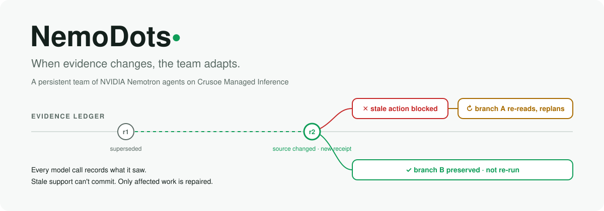
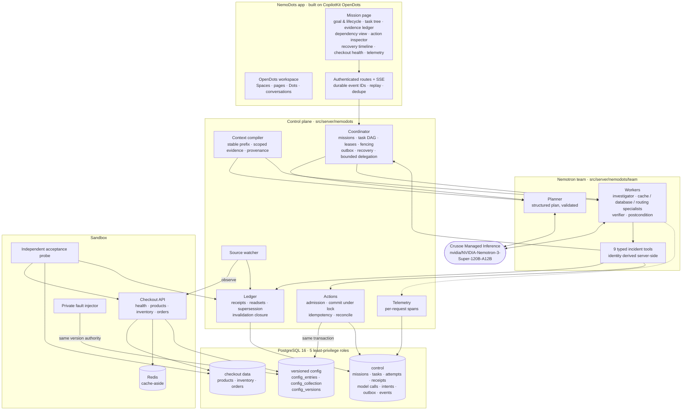
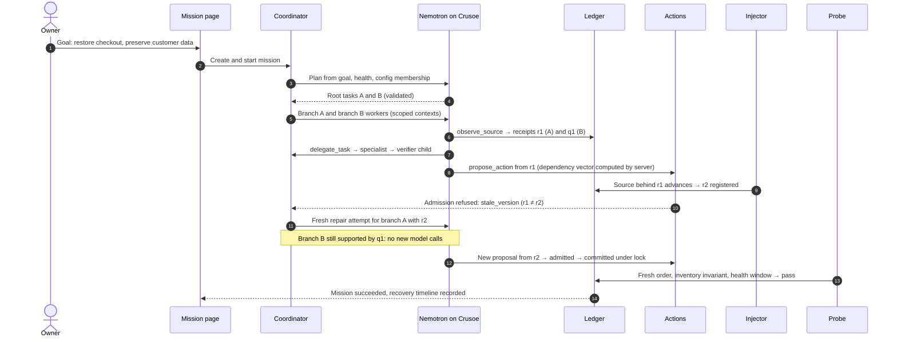
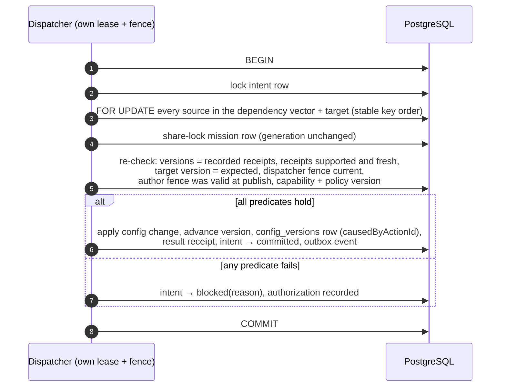

<div align="center">

<picture>
  <source media="(prefers-color-scheme: dark)" srcset="assets/readme/hero-dark.svg"/>
  
</picture>

**A persistent team of NVIDIA Nemotron agents that restores a broken application while keeping its shared evidence current.**<br/>
Give NemoDots one goal. A Nemotron planner splits it into investigations, specialists delegate narrower work to their own children, and every observation lands in a typed evidence ledger. When a source changes underneath them, actions built on the old evidence are refused at commit time, only the affected branch is repaired, and independent work carries on. An independent probe, not the model, decides when the job is done.

[](#hackathon-submission)
[](#crusoe-and-nemotron-the-reasoning-layer)
[](#crusoe-and-nemotron-the-reasoning-layer)
[](#postgresql-the-authority-layer)

[](NemoDots/docs/nemodots/TOOL_COVERAGE.md)
[](#the-guarantee)
[](NemoDots/docs/nemodots/STACK.md)
[](#the-sandbox)
[](NemoDots/docs/nemodots/ACCEPTANCE_CONTRACT.md)
[](#built-to-fail-closed)
<br/>
[](NemoDots/tsconfig.json)
[](NemoDots/package.json)
[](NemoDots/src/client)
[](NemoDots/src/server)
[](NemoDots/docs/nemodots/STACK.md)
[](https://github.com/CopilotKit/OpenDots)
[](NemoDots/vitest.config.ts)

[Hackathon](#hackathon-submission) · [How it works](#how-it-works) · [Architecture](#architecture) · [The guarantee](#the-guarantee) · [Evidence ledger](#the-evidence-ledger) · [PostgreSQL](#postgresql-the-authority-layer) · [Crusoe + Nemotron](#crusoe-and-nemotron-the-reasoning-layer) · [Quick start](#quick-start) · [Demo](#the-demo) · [Evaluation](#evaluation) · [Docs](#documentation)

</div>

## Why NemoDots

Autonomous specialists keep acting on observations another specialist has already disproved. Conversation history and shared memory preserve the obsolete premise, so a team repeats investigations, executes a plan that no longer fits the system, or throws away good work and restarts from scratch.

NemoDots works under three rules:

- **Every model call records what it saw.** The ledger stores the exact receipts, revisions and digests injected into each request, including tool results, inherited findings and runbooks. Lineage does not depend on what the model chose to cite.
- **Stale support cannot commit.** A controlled change commits only if every source it depends on is still at the version the agent saw, checked under lock in the same PostgreSQL transaction as the change itself. Approval never bypasses that check.
- **Only affected work is repaired.** When a source changes, the descendants of that evidence are invalidated and re-planned from fresh reads. Branches built on independent evidence keep their results and are not re-run.

## Hackathon submission

| | |
|---|---|
| **Event** | The Recursive Agents Hackathon · Crusoe × Cerebral Valley · San Francisco · 17 October 2026 |
| **Theme** | "Build a team of agents you can walk away from": agents that take a goal, plan, spin up sub-agents, delegate, communicate, check their own progress, recover when things break, and keep going |
| **Crusoe Managed Inference** | Runs every runtime decision: planning, specialist investigation, recursive delegation, verification reasoning and evidence-triggered replanning |
| **NVIDIA Nemotron** | `nvidia/NVIDIA-Nemotron-3-Super-120B-A12B` is the planner and every specialist |
| **Team** | [@charliegillet](https://github.com/charliegillet) |

How NemoDots answers the brief:

- **Take a goal and run with it.** A mission starts from one sentence ("Restore checkout availability while preserving customer data"). The planner decides the tasks; no plan, tool argument or diagnosis is scripted.
- **Delegate and spin up sub-agents.** Investigators cannot propose repairs, so they must delegate to specialists, and specialists can spawn verifier children. Depth, breadth, total tasks and capabilities are bounded server-side.
- **Communicate and remember.** The team shares one typed evidence ledger instead of a shared transcript. Findings cite receipts; they can never mint them.
- **Check progress and recover.** Leases with fencing tokens, an outbox, and crash recovery keep the team running through worker crashes, Redis loss and provider outages, with honest `outcome_unknown` states instead of invented success.
- **Know when it is done.** A mission succeeds only when an independent probe places and reads back a real order, verifies inventory and data invariants, and sees the service stay healthy for a full window.

## How it works

| | Step | Powered by |
|---|---|---|
| **1** | **Goal.** The owner creates a mission from the NemoDots mission page with a goal and constraints. Authority comes from the authenticated server scope, never from model-supplied IDs. |   |
| **2** | **Plan.** The Nemotron planner reads the goal, live health and the config membership (not its values) and emits 2–6 root tasks as validated structured output, with roles, capabilities and causal dependencies. |   |
| **3** | **Investigate.** Workers run a bounded tool loop over nine typed tools: `observe_source`, `list_runbooks`, `read_runbook`, `get_task_status`, `wait_for_children`, `publish_finding`, `delegate_task`, `propose_action`, `request_replan`. Every read becomes an immutable observation receipt. |   |
| **4** | **Delegate.** Investigators delegate repairs to cache, database or routing specialists; specialists may spawn a verifier child. Parentage, capabilities and every model request are tracked. | Coordinator · leases · fencing tokens |
| **5** | **Propose.** A specialist proposes a config change. The server computes its dependency vector from what the emitting model call actually saw, binds the idempotency key to the payload hash, and queues it for admission. | Action admission (G1) |
| **6** | **Evidence changes.** The fault injector or an operator edit advances a source through the same version authority. The watcher records a new receipt and the old receipt stops being current at that commit. |  Watcher |
| **7** | **Block and repair.** The queued action is refused with `stale_version`. Its branch gets a fresh repair attempt with scoped current reads, and Nemotron re-plans it. The independent branch is untouched. |  Invalidation closure |
| **8** | **Commit and verify.** The corrected action commits under lock. Its own write is recognized as an expected transition (`causedByActionId`), not a repair trigger. The independent probe then decides whether the mission succeeded. |  |

## Architecture



### One mission, end to end



### Inside a controlled commit

<details>
<summary><b>Admission, lock order, and why a stale intent cannot slip through</b></summary>



Admission runs the same predicates earlier; commit re-executes every one of them under lock. No LLM, Redis or HTTP call ever happens inside the transaction.

</details>

## The guarantee

NemoDots makes one narrow promise and enforces it in the database rather than in a prompt.

| | Guarantee | Enforced by |
|---|---|---|
| **G1** | A controlled configuration change commits only if every source in its dependency vector is still at the recorded version, its receipts are supported and fresh, the target is at the expected version, and the dispatcher's fence is current, all checked under lock in the same transaction as the change | `actions/` · PostgreSQL row locks in stable key order |
| **G2** | A finding, handoff, child task or model-call record is accepted only while its support is current, with the controlled rows share-locked during publication | `SupportValidator` · `FOR SHARE` |
| **G3** | When a controlled source advances, every receipt of the old version is non-current from that commit on, before any watcher runs. A pending replacement observation fails closed | Version comparison under lock · `stale_pending_observation` |

Its limits are stated in the UI and the report: G1 covers controlled sources only. Observed sources (health, metrics, Redis stats, inventory, pages) get freshness-at-admission; the Redis cache flush gets freshness-at-dispatch with fencing and readback, and can end in `outcome_unknown` until reconciled. Nothing outside the nine incident tools is covered, so arbitrary shell, browser or HTTP side effects are not exposed to the team at all.

## The evidence ledger

The ledger is the team's shared memory and its source of authority. Pages remain editable narrative projections that link back to typed records.

| Record | What it holds |
|---|---|
| **ObservationReceipt** | Immutable ID, mission/environment/resource scope, source key, observation time, source revision, content digest, normalized value, status (`supported`, `contested`, `superseded`, `retracted`, `expired`), supersession links, trust class |
| **ModelCallRecord / ContextSnapshot** | Request, mission, task, attempt and model; every injected receipt with revision and digest; inherited findings; runbook digests; tool-schema hash; prefix and context digests; tokens and timing |
| **Collection and negative evidence** | Range revisions for reads like "no restrictive policy exists", so inserting a restriction invalidates the absence observation |
| **TaskAttempt / DependencyEdge** | Parentage, causal evidence edges kept distinct from scheduling edges, lease owner, expiry, monotonically increasing fencing token, budgets |
| **ActionIntent / ResultReceipt** | Exact payload and hash, target, dependency vector, expected version, policy version, idempotency key, authoring and dispatch fences, and a status from `proposed` through `committed`, `verified`, `blocked` or `outcome_unknown` |
| **Invalidation / RecoveryEvent** | Old and new receipt, affected attempts, outputs and actions, preserved branches, scheduled repairs, idempotent event ID |

Findings from the model are claims with `trust: model_claim`. They cite receipts but can never create one.

## PostgreSQL: the authority layer


PostgreSQL is the source of truth for missions, tasks, attempts, leases, receipts, read sets, intents, events and the outbox. OpenDots' SQLite keeps workspace and page metadata; Redis only caches and wakes workers, so losing it delays work but never loses it.

- **One version authority.** Source versions and the checkout's supported config targets share one database and one transaction boundary. The fault injector writes through the same authority as legitimate repairs.
- **Per-resource versions.** Each source has its own explicit row version, not a mission-wide epoch, which is what makes selective repair possible. A run generation exists only for whole-mission cancel and restart.
- **Five least-privilege roles.** `nemodots_admin` (migrations), `nemodots_app` (control plane), `nemodots_checkout` (the checkout API), `nemodots_injector` (faults) and `nemodots_verifier` (the independent probe). Model tools never see any database credential.
- **Fenced leases and an outbox.** Every publish, delegation and commit checks the active fencing token, so a worker that lost its lease cannot write. Outbox delivery and unknown action outcomes recover after a crash.
- **Bounded retries.** Serialization and deadlock failures retry with jitter; no transaction is held open across a model or network call.

## Crusoe and Nemotron: the reasoning layer

 

All runtime reasoning runs on Nemotron through Crusoe Managed Inference, via the OpenAI-compatible endpoint `https://api.inference.crusoecloud.com/v1`. There is no fallback provider: if Crusoe is unreachable, the mission visibly moves to `blocked_provider` instead of continuing from a canned plan.

- **Cache-aware context layout.** The context compiler emits one deterministic system prompt: common instructions and ordered tool schemas, then stable runbook context, then role instructions, then the scoped versioned evidence, task and time. The stable prefix is identical for calls with the same permissions, which suits Crusoe's MemoryAlloy prefix caching. Unauthorized context is never shared to improve cache hits, and prompts are never padded.
- **Structured and typed.** Plans are validated JSON; tool calls are validated per schema with one bounded correction turn, then a visible failure. Reasoning is switched off for tool loops with `reasoning_effort: "none"`.
- **Rate-aware.** At most four requests in flight per model, jittered exponential backoff on 429 and 503, and a clear line between retrying an inference call (safe) and retrying a mutating tool (never automatic). A retried stream tells its consumer to reset, so text is never duplicated.
- **Measured honestly.** Every request records mission, task, attempt, requested and returned model, host, time to first non-empty token, input, output and cached tokens, retries and prefix digests. Cached tokens that the provider does not return are shown as unavailable, never as zero.

## The sandbox

A real local application, not a mock: a Hono checkout API over PostgreSQL inventory and orders, with Redis cache-aside, health, metrics, products and a create/read order flow.

| Config key | Fault class | What the team can observe | Bounded repair |
|---|---|---|---|
| `cache.namespace` | **F1** stale namespace | cached blobs carry an older schema suffix | set a correct namespace, or flush |
| `cache.schema_version` | **F2** schema mismatch | `500 cache_decode_error`, expected vs found schema in metrics | set the matching version, or flush |
| `db.pool_max`, `db.statement_timeout_ms` | **F3** pool starvation | `503 pool_timeout` under load, health `degraded` | raise the pool size |
| `routing.inventory_source` | **F4** stale replica routing | API view of inventory disagrees with the authority | route to `primary` |
| `orders.write_enabled` | **F5** maintenance flag | `503 writes_disabled` | re-enable writes |
| `ui.banner_text` | **B1** benign control | nothing | none: it must not invalidate anything |

Runbooks describe the system, never the baseline or scenario values, and the private scenario manifests are unreadable to the team. Diagnosis has to come from what the agents observe.

## Built to fail closed

- **No LLM judge.** A mission succeeds only on the probe's `pass` with zero open invalidations. A model saying "fixed" changes nothing.
- **Approval is not authority.** An approval binds the exact payload and dependency snapshot; if evidence changes in between, the action is revalidated and refused.
- **Idempotency bound to payload.** Reusing an idempotency key with a different payload fails. Duplicate delivery returns the original receipt instead of writing twice.
- **Separate fences for authoring and dispatch.** A finished author's valid proposal can still execute under a new dispatcher lease; an expired author cannot publish and an expired dispatcher cannot commit.
- **Self-writes are expected, not alarming.** A committed action that advances its own target is routed to postcondition verification, not a repair storm. The model cannot forge that marker.
- **Untrusted text stays data.** Instructions inside logs, tool results, pages or runbooks cannot change checks, providers or permissions.
- **Live, fixture and blocked are labelled.** Fixture runs are stamped and never counted as live trials; missing configuration shows exactly which variable names are missing.

## Quick start

Requirements: Node `>=24`, npm, and native PostgreSQL 16 and Redis 8 (for example from Homebrew). Docker is not required. NemoDots runs its own instances on ports 55432 and 56379 and refuses to touch 5432 or 6379.

```bash
cd NemoDots
npm ci
cp .env.example .env    # set OPENAI_BASE_URL, OPENAI_MODEL and OPENAI_API_KEY for Crusoe
```

```bash
npm run nemodots:stack -- init
npm run nemodots:stack -- start
npm run nemodots:migrate
npm run nemodots:seed
npm run dev             # then open http://localhost:5173/#/missions
```

`.env` values for live mode:

```dotenv
OPENAI_BASE_URL=https://api.inference.crusoecloud.com/v1
OPENAI_MODEL=nvidia/NVIDIA-Nemotron-3-Super-120B-A12B
OPENAI_API_KEY=<your Crusoe inference key>
# optional: OpenDots conversations through CopilotKit Intelligence
CPK_INTELLIGENCE_API_KEY=<your CopilotKit key>
```

Without a Crusoe key the mission page opens in **BLOCKED** mode and lists the missing variable names; past missions, evidence and checkout health stay browsable.

Tests and reports:

```bash
npm test                          # Node-only, no network or database
npm run test:nemodots:db          # ledger, coordinator, actions and races on real PostgreSQL
npm run test:nemodots:live        # Crusoe/Nemotron through the app's own adapter
npm run test:nemodots:e2e         # browser tests against the integrated backend
npm run test:nemodots:acceptance  # the independent verifier's frozen acceptance suites
npm run nemodots:evals            # baselines and selective repair on held-out scenarios
npm run nemodots:report           # run manifest and results export
```

## The demo

1. Open the mission page and create a mission with the goal **"Restore checkout availability while preserving customer data."** The badge shows **LIVE** with the Crusoe host and model.
2. Press **Run injector** for a repairable checkout fault. Health turns `degraded` and orders start failing.
3. Watch the task tree: the planner creates root tasks, an investigator delegates to a specialist, and the specialist spawns a verifier child.
4. The evidence ledger fills with receipts as workers call `observe_source`. Each row shows source, revision, status and which branches consume it.
5. A specialist proposes a config change; the action inspector shows its payload, dependency vector and expected versions.
6. The injector, or a manual **Edit source**, changes a value that proposal depends on. A new receipt appears and the old one is marked superseded.
7. The action inspector shows the intent **blocked: stale_version**. The dependency view highlights the affected region, and the recovery timeline records the re-read and the new attempt, while the independent branch shows no new model calls.
8. The corrected action commits, and the probe places a real order, checks inventory, and holds health `ok` for the full window. The mission turns **succeeded**.

The full walkthrough, including the manual source-edit path, is in [DEMO.md](NemoDots/docs/nemodots/DEMO.md).

## Evaluation

NemoDots is compared against two baselines that use the same tools, policies, action checks, model and budget, on frozen held-out scenarios with benign controls:

| Strategy | On a source change |
|---|---|
| **Temporal memory + broad restart** | Receives the same change notifications, then re-runs all mission work affected at a coarse level |
| **Dependent-task restart** | A conventional task DAG with the same admission checks; restarts the dependent subtree |
| **NemoDots selective repair** | Invalidates only work whose recorded evidence changed, preserves independently supported branches |

A second, matched 2×2 study crosses broad versus selective recovery with ordinary versus cache-aware context layout, keeping information, tools and models identical. Correctness is reported separately from efficiency: verified resolution, stale controlled commits, unsafe actions, false blocks, missed and false invalidations, preserved work, repeated calls and tokens, unknown outcomes, and recovery time. Every trial is exported, failures included, in [EVALUATION.md](NemoDots/docs/nemodots/EVALUATION.md) and [RESULTS.md](NemoDots/docs/nemodots/RESULTS.md). Rare races are proven separately with deterministic barrier tests, never by forcing a model's choice.

## Repository layout

| Path | What |
|---|---|
| `NemoDots/` | The application: CopilotKit OpenDots extended with the NemoDots control plane, sandbox and mission page |
| `NemoDots/src/server/nemodots/contracts` | Zod contracts: receipts, model calls, tasks, intents, invalidations, events |
| `NemoDots/src/server/nemodots/{db,config}` | Migrations, transactions with bounded retry, role pools, typed environment |
| `NemoDots/src/server/nemodots/ledger` | Receipts, read sets, supersession, invalidation closure, support validation |
| `NemoDots/src/server/nemodots/coordinator` | Missions, task DAG, leases and fencing, outbox, recovery, delegation limits |
| `NemoDots/src/server/nemodots/actions` | Admission and commit transactions, idempotency, dispatch and reconcile |
| `NemoDots/src/server/nemodots/{context,inference,team}` | Context compiler, Crusoe adapter, Nemotron planner, workers and the nine tools |
| `NemoDots/src/server/nemodots/{watcher,routes,telemetry}` | Source watcher, authenticated API and SSE stream, per-request spans |
| `NemoDots/src/server/nemodots/sandbox` | Checkout API, seed, fault injector, version authority, acceptance probe |
| `NemoDots/src/client/nemodots` | Mission page, event stream reducer, evidence and recovery views |
| `NemoDots/tests/nemodots` | Unit, integration, race, live, browser and acceptance suites |
| `NemoDots/evals/nemodots` | Scenarios, baselines, scoring; `frozen/` holds the verifier's held-out set |
| `NemoDots/docs/nemodots` | Architecture, contracts, coverage, acceptance contract, results and limitations |
| `HACKATHON_AND_CRUSOE_GUIDE.md`, `LITERATURE_REVIEW.md` | Event and Crusoe research, and the prior-art review behind the design |

## Documentation

| | |
|---|---|
| [Architecture](NemoDots/docs/nemodots/ARCHITECTURE.md) · [Contracts](NemoDots/docs/nemodots/CONTRACTS.md) · [Tool coverage](NemoDots/docs/nemodots/TOOL_COVERAGE.md) | Module map, the guarantee and its limits, state machines, typed contracts and every execution path |
| [Local stack](NemoDots/docs/nemodots/STACK.md) · [Demo](NemoDots/docs/nemodots/DEMO.md) | Running PostgreSQL, Redis and the checkout API natively; the demo walkthrough |
| [Acceptance contract](NemoDots/docs/nemodots/ACCEPTANCE_CONTRACT.md) · [Verification report](NemoDots/docs/nemodots/VERIFICATION_REPORT.md) | Frozen oracle, held-out manifest and hashes; gate-by-gate PASS / FAIL / BLOCKED / NOT_RUN with evidence |
| [Evaluation](NemoDots/docs/nemodots/EVALUATION.md) · [Results](NemoDots/docs/nemodots/RESULTS.md) · [Limitations](NemoDots/docs/nemodots/LIMITATIONS.md) | Baselines, the 2×2 context study, per-trial exports and what is outside the guarantee |
| [Build prompt](NemoDots/docs/nemodots/BUILD_PROMPT.md) · [Test prompt](NemoDots/docs/nemodots/TEST_PROMPT.md) · [Lead notes](NemoDots/docs/nemodots/LEAD_NOTES.md) | The specification the team built and verified against |

## Team

[@charliegillet](https://github.com/charliegillet). NemoDots was built by a team of Claude agents orchestrated as deterministic workflows: Claude Fable 5.1 ran the source audit, architecture and the three architecture devil's advocates; Claude Opus 5.5 ran reviewers, the concurrency and integration adversaries, the independent verifier and integration; Claude Sonnet 5.5 built the engines, sandbox and UI. The product's own runtime reasoning is Nemotron on Crusoe; the two model systems are kept separate in configuration, telemetry and docs. Work lands on the `nemodots` branch.

## License

`NemoDots/` is built on [CopilotKit OpenDots](https://github.com/CopilotKit/OpenDots) and keeps its MIT license (© Atai Barkai); the pinned OpenBot computer service is MIT (© CopilotKit). See [NemoDots/LICENSE](NemoDots/LICENSE) and [THIRD_PARTY_NOTICES.md](NemoDots/THIRD_PARTY_NOTICES.md). NVIDIA, Nemotron, Crusoe, CopilotKit, PostgreSQL and Redis are trademarks of their owners; their use here does not imply endorsement.

<sub>NemoDots does not claim to prevent action on changes it never observed, to make external side effects atomic, or to be "never stale". The strong guarantee covers controlled commits against registered evidence under one PostgreSQL authority.</sub>
